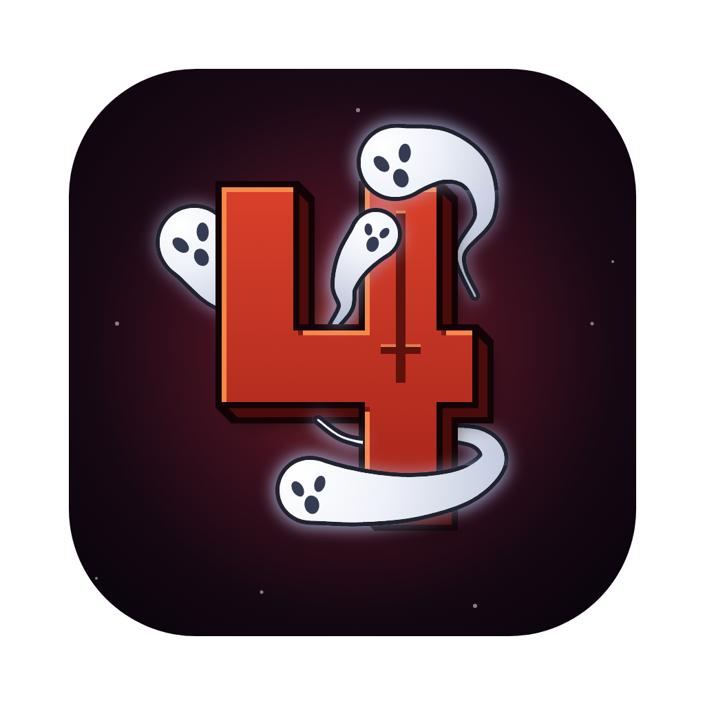
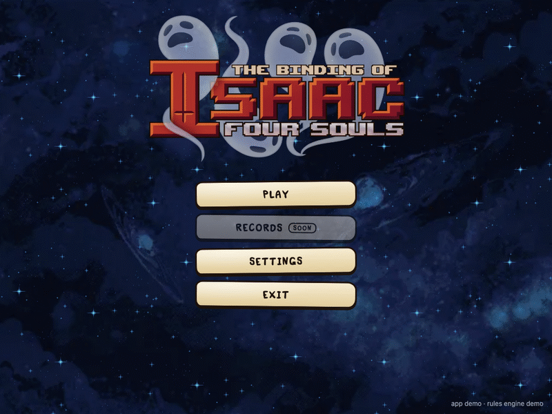

# Four Souls

<p align="center">
  
</p>

Unofficial, free, fan-made desktop version of the card game
*The Binding of Isaac: Four Souls* for 2–4 players over the network.
Built with [Wails](https://wails.io) (Go + React/TypeScript).

The game belongs to Edmund McMillen and Maestro Media.
Please [buy the physical game](https://foursouls.com).

<p align="center">
  
</p>

## Features

- **The rules are handled for you.** The server runs every card, roll, attack and
  the stack. Nobody needs to look up a rule or keep count by hand.
- **Easy to set up and play.** Unzip and start: no installer, no account.
  Host a game in the app, or find one on your local network and join.
- **Animations.** Cards fly, dice roll, damage shots hit their targets,
  so you always see what just happened on the table.
- **Base game, Gold Box, Four Souls+ and Requiem**, with the Requiem room deck,
  plus co-op [challenges](docs/wiki/Challenges.md) for 2 players.
- **Play over the internet** through a virtual LAN, port forwarding,
  or your own [dedicated server](docs/wiki/Dedicated-server-on-a-VPS.md).
- **Bots.** Not enough players? The host seats standard or hard bots on free
  seats; one player and three bots make a full table. See
  [Playing with bots](docs/wiki/Playing-with-bots.md).

## Download

Get the archive for your system from
[Releases](https://github.com/FourSoulsRepo/four_souls/releases):

| System | File |
|---|---|
| Windows (64-bit) | `four-souls-<version>-windows-amd64.zip` |
| macOS (Intel and Apple Silicon) | `four-souls-<version>-macos-universal.zip` |

The app is not code-signed: `README.txt` inside, or the wiki page
[First start](docs/wiki/First-start.md), shows how to open it the first time.

Several copies can run on one computer; each is its own player.
On macOS start another copy with `open -n FourSouls.app`.

## Run in dev mode

```sh
wails dev -m
```

## Build

```sh
go generate ./pkg/card_db/images
wails build -m -tags "embed cardimages"
```

Card images come from a private submodule (`pkg/card_db/images`). Without access, build with `-tags embed`; cards then show as text.
`-m` skips `go mod tidy`, which fails without the submodule.

The binary lands in `build/bin/`.

## Develop

Tools: `scripts/setup.sh` (macOS, Linux), then `make doctor`;
see [Developer setup](docs/wiki/Developer-setup.md).

```sh
make build vet test lint wasm
cd frontend && npm run typecheck && npm run lint
```

Wiki for players, server admins, translators and developers: [docs/wiki/Home.md](docs/wiki/Home.md).
To translate the game: [Translate the interface](docs/wiki/Translate-the-interface.md).
Plan: [docs/roadmap.md](docs/roadmap.md).

## License

Code: MIT ([LICENSE](LICENSE)). Third-party items: [NOTICE](NOTICE).
