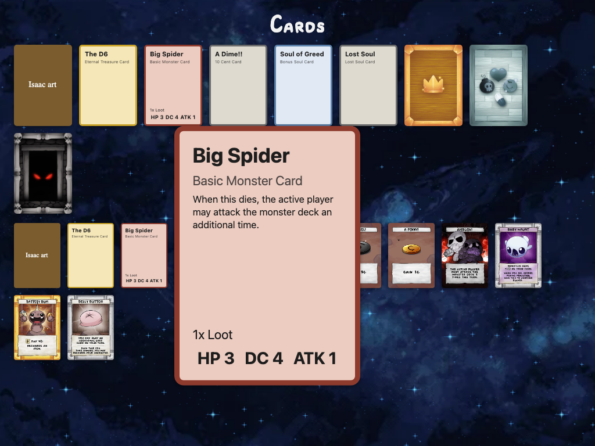

# Adding a card

This guide takes you from nothing to a working, tested card. You need Go (see `go.mod` for the version) and a clone of this repository. Card images are not needed.

Cards are Go values. Each card is one short file built from the blocks listed on [Effect blocks](Effect-blocks); a card the blocks cannot express gets a small Go function.

## 1. Find or make the stub

Base Game cards live in `pkg/rules_engine/cards/b2/`, one file per card, named after the card ID: `the_d6.go`, `a_nickel.go`. Gold Box is `cards/g2/`, Four Souls+ is `cards/fsp2/`. Challenge cards are `cards/challenge/` (ADR 028): the boss is a `MonsterCard` with `Outside`, a rule card a `ChallengeCard`; that set is not in `cards.Sets()`. A two-sided card (ADR 023) gets its back face in the same file: the front's `Back` names it, and the set list ends with the backs (Requiem's The Revenant, Trick or Treat's `treat_normhardultra`). Pieces many cards share (a character's extra loot play, "recharge an item", "deal 1 damage to a monster or player", …) live in `cards/cardkit/`; each set's `common.go` gives them short local names.

A card that an older set already has (a reprint, ADR 010) is not written again: the generator lists it under the set's `Reprints`, which only adds that set's copies to the decks.

If the card exists in `card_db`, the generator has already written a stub:

```sh
go run ./cmd/cardgen -set b2
```

A stub has the printed text as a comment, the game data (kind, copies, HP, ATK, DC, soul, rewards, keywords) and a `TODO(card):` line:

```go
// Bomb! (Bomb Card)
//
//	Deal 1 damage to a monster or player.
//
// TODO(card): implement the text above, then delete this line.
// Until then `go run ./cmd/cardgen` rewrites this file from card_db.
var bomb = engine.CardDef{
	Ref:    "bomb",
	Kind:   engine.LootCard,
	Copies: 4,
}
```

While the `TODO(card):` line is there the generator rewrites the file. Delete it when you start: from then on the file is yours. Keep the variable name; the set list (`set_gen.go`) refers to it.

## 2. Write the card

A zoomed card shows its full text:



Add what the text does. Most cards are a few blocks.

A loot card: its loot ability happens when it resolves; targets are chosen when it is played.

```go
var bomb = engine.CardDef{
	Ref:    "bomb",
	Kind:   engine.LootCard,
	Copies: 4,
	Abilities: []engine.Ability{{
		Kind:    engine.LootAbility,
		Text:    "Deal 1 damage to a monster or player.",
		Targets: []engine.TargetSpec{engine.Choose(engine.TargetMonsterOrPlayer)},
		Effects: []engine.Effect{engine.DealDamage(1, 0)},
	}},
}
```

An item with a ↷ ability and a trigger:

```go
var theD6 = engine.CardDef{
	Ref: "the_d6", Kind: engine.TreasureCard, Copies: 1, Eternal: true, Outside: true, Tap: true,
	Abilities: []engine.Ability{
		{
			Kind:    engine.Activated,
			Text:    "↷: Choose a dice roll. Its controller rerolls it.",
			Costs:   []engine.Cost{engine.Tap()},
			Targets: []engine.TargetSpec{engine.Choose(engine.TargetDiceRoll)},
			Effects: []engine.Effect{engine.RerollRoll(0)},
		},
		{
			Kind:    engine.Triggered,
			Text:    "At the end of your turn, recharge this.",
			Trigger: engine.AtEndOfYourTurn(),
			Effects: []engine.Effect{engine.RechargeSelf()},
		},
	},
}
```

A monster: stats and rewards come from the stub; "when this dies" is a trigger. On a monster card, "you" is the active player.

```go
var boomFly = engine.CardDef{
	Ref: "boom_fly", Kind: engine.MonsterCard, Copies: 1, HP: 1, DC: 4, ATK: 1,
	Rewards: []engine.Reward{{Kind: engine.RewardCents, Amount: 4}},
	Abilities: []engine.Ability{{
		Kind:    engine.Triggered,
		Text:    "When this dies, it deals 1 damage to each player.",
		Trigger: engine.WhenThisDies(),
		Effects: []engine.Effect{engine.EachPlayer(engine.DealDamage(1, engine.You))},
	}},
}
```

A custom hook, when no block fits: `EffectFunc` gets the context (`c.G` is the game, `c.Controller` the player, `c.Targets` the chosen targets) and may call the game's exported methods.

```go
Effects: []engine.Effect{engine.EffectFunc(func(c *engine.Ctx) {
	c.G.Players[c.Controller].Cents = 0
})},
```

Things decided while the card resolves ("choose a deck", "a card from your hand") are questions: see "Questions on resolution" on [Effect blocks](Effect-blocks). Targets and "choose one-" are chosen when the card is played, never on resolution (R-ABIL-04).

A question and its options are never English in Go: each is a key, and its words live in `frontend/src/locales/en.json` (ADR 021). Declare a card's own keys at the top of its file and add each one to `en.json`, in its sorted place, with the words and a note that says where it shows and what each value is:

```go
// The card's own lines; their words are in en.json (ADR 021).
var (
	cheeseGraterPutBack = engine.NewKey("card.cheese_grater.put_back")
	cheeseGraterDiscard = engine.NewKey("card.cheese_grater.discard")
)
```

```json
"card.cheese_grater.put_back": {
  "text": "put it back",
  "note": "Option of Cheese Grater's question: put the revealed card back on its deck."
},
```

Questions many cards ask are shared: `cardkit.AskDiscardWhich`, `cardkit.May(key, …)` with yes and no, `engine.DeckQuestion(key)`, card and player options (`c.G.Labels`, `cardkit.PlayerLabels`). Then run `go test . -run TestServerKeys -update` from the repo root: it lists every key in `frontend/src/locales/server-keys.json`, and fails while a key has no line in `en.json`.

A card that takes from a player no target names sets `Takes` on that ability: it steals, or makes a player discard, lose ¢, or destroy an item or soul, and picks that player only as it resolves (XV. The Devil, Joker, "each player discards their hand"). `TakesOthers` means any player but its controller; `TakesEventPlayer` means the player of the triggering event, e.g. Dead Bird's "a player rolls a 3". The server then stops "Wait for my turn" for those players while the card is on the stack, so they can still answer it (15.85). Add the card to `TestTakes` in `pkg/rules_engine/cards/cards_test.go`. A card whose targets name every victim (Jawbone) and damage need no `Takes`: the server sees them already.

A card whose effect acts on the attack in progress sets `Attack` on that ability, or on that "choose one-" mode: `NeedsAnAttack` ("Cancel an attack.", Lord of the Pit), `NeedsYourAttack` (The Bible), `NeedsAttackOnMonster` (Emergency Contact), `NeedsYourAttackOnMonster` (IBS). The attack counts as its target: with no such attack the card can't be played or used, and a mode is not offered (R-ABIL-40, Q-55, 19.237). An attack is in progress from its declaration till it ends; it is on a monster once its target is one. The effect checks the same on resolution with `c.G.AttackFor(need, c.Controller)`. A triggered ability needs no `Attack`: it is never played.

A condition for using an ability that is not before its colon is no cost (R-ABIL-07); it goes in `Needs`. A limit the card states ("This can't be activated during an attack.", Red Key) is `OnlyIf(say, ok)`, refused by R-ABIL-08; ? Card's copy keeps it too (19.243). A thing it acts on that no target spec names ("a monster from under this", Friendly Ball) is `ActsOn(ok)`: with none it has no valid target (R-ABIL-40), and ? Card does not offer it (19.242).

Rules follow our rules text in `pkg/rules_engine/docs/rules/`; each rule has an ID such as `R-DEATH-14`. When the card text and a rule seem to disagree, add the case to `open-questions.md` instead of guessing.

## 3. Test it

A card's tests start as situation files: small JSON files that build a table, play, and say what must be true afterwards (ADR 034). The format is on [Situation payload](Situation-payload). A test the format can't say is Go. One card may have both: files for its simple cases, a `<card>_test.go` for the rest.

### Simple or complicated

A test is **simple**, so a file, when the format states its setup, its steps and its checks, and no engine state is set by hand outside `setup`. Most card tests are: play the card or use it, attack, end the turn, answer the questions; then check cents, damage, HP, items, hands, decks and discards, monsters, counters, the open question, the resolve order, events and dice values. A table of fixed cases ("Roll-: 1-2 …, 3-4 …, 5-6 …") is one file per case, not one test with a loop.

A test is **complicated**, so Go, when it needs:

* a loop that computes values;
* a check against a value read earlier in the test: `TestRulingDamageToDeadPlayer` compares the damage with the damage before the play;
* views, hidden cards, records, replay, save and load, or undo;
* helpers and engine APIs that are no game action (`cardkit.DieFaces`, `CheckInvariants`);
* random runs: whole games, fuzz, sims; or a real game start (a starting item, the first player).

A setup field or check the format lacks is added to the format first, with its line on [Situation payload](Situation-payload). A test stays Go only when that field would serve no other test, as an event's `Amount` or a question's text key.

### Where the file goes

Paths are relative to `pkg/rules_engine/`:

| The test is about | File |
|---|---|
| one card | `cards/<set>/testdata/situations/<card>/<case>.json` |
| several cards of one set together | `cards/<set>/testdata/situations/interactions/<cards>.json` |
| cards of several sets | `cards/testdata/situations/interactions/<cards>.json` |
| an engine rule, with the test sets only | `testdata/situations/<topic>/<case>.json` |

`<card>` is the card's ref (`bomb`). `<case>` says what is checked, in kebab case (`kills-the-fly.json`); an interaction is named after its cards (`lucky-foot-bomb.json`). A card the test only needs as a prop (the Fly a Bomb! kills) makes no interaction: the file goes in the tested card's folder. A folder holds only `.json` files, with no deeper levels, and the runner fails a file outside this layout. The status report counts a card as tested by its own folder or its `<card>_test.go`; an `interactions/` file does not count.

A set's first file also needs the set's runner, `situations_test.go` (`cards/b2/situations_test.go` is the model; see [Situation payload](Situation-payload), "The runner"). Base Game, Gold Box, Four Souls+, Requiem and the challenges have one.

### `source` and the expected values

Every test file has `source`: a non-empty list of what its `expect` values come from.

* `card <ref>`: the card's own text.
* `R-<TOPIC>-<NN>`: a rule in `pkg/rules_engine/docs/rules/`.
* `Q-<NN>`: a resolved question in `open-questions.md`; `R-07 #<N>`: an old ruling re-checked there; an `https://` link: a ruling outside the repo.
* An open question only in a file whose `title` says it waits for it: "(waits for Q-27, still open: checks the engine's current answer, (a))" (ADR 034 9.8). Such a file checks what the engine does today, until the owner answers.

The runner checks each form, and that the card, rule or question exists.

The expected values come from these sources, never from running the code (CLAUDE.md 5.25): write `expect` from the card text and the rules before the first run. If the run disagrees, the code is the bug: log it in `docs/roadmap/19-bugs.md` (CLAUDE.md 5.17), don't change the file to match.

Each file must fail with one expected value changed. Change a value (Cain's damage 1 to 2), run the file, see it fail, put it back. A check that passes either way checks nothing; the move of the old Go tests found several such checks.

### A worked example

Bomb! from step 2 says "Deal 1 damage to a monster or player." Its first file, `cards/b2/testdata/situations/bomb/kills-the-fly.json`:

```json
{
  "title": "Isaac plays Bomb! on the Fly (1 HP): does it die, and does Isaac get its 1¢?",
  "source": ["card bomb", "card fly", "R-CARD-07", "R-CARD-13"],
  "sets": ["b2"],
  "setup": {
    "players": [{"character": "isaac", "hand": ["bomb"]}, {"character": "cain"}],
    "active": 0,
    "monsters": ["fly", "leech"]
  },
  "action": {"player": 0, "kind": "play", "card": "bomb", "choices": ["fly"]},
  "expect": {
    "allowed": true,
    "monsters": [{"card": "fly", "dead": true}, {"card": "leech", "slot": 2, "damage": 0}],
    "after": [{"player": 0, "cents": 1}],
    "discards": {"loot": ["bomb"]}
  }
}
```

Each value has its source: the card deals 1 damage, so the Fly (1 HP, `card fly`) dies and the Leech is untouched; the active player gets the Fly's 1¢ (R-CARD-13); the played loot card goes to the loot discard (R-CARD-07). Choices answer the prompts by label: a card's ref (`"fly"`), a player (`"player 2 (cain)"`), a number, or an option's key and values (`"ask.yes"`, `"ask.keep_on_top bomb"`).

Run the card's files, one file, or the whole set's:

```sh
cd pkg/rules_engine
go test ./cards/b2 -run 'TestSituations/^bomb$/' -v
go test ./cards/b2 -run 'TestSituations/^bomb$/^kills-the-fly$' -v
go test ./cards/b2 -run TestSituations
```

Each part of `-run` between the slashes is a regular expression for one level of the subtest name, so `^bomb$` keeps out `gold_bomb` and `mega_troll_bomb`.

A mismatch names the file, the step and the value: `bomb/kills-the-fly.json, step 1 (play bomb): player 0 cents is 1, expected 2`. The card needs no Go test.

### Start from the dump

For a long setup it can be quicker to build the table with the `enginetest` helpers below and let the dump write the draft. Write a short Go test that only sets up and plays, run it with `SITUATION_DUMP`, and finish the draft as [Situation payload](Situation-payload) says ("Dump a Go test"): a `title` as a question, `source`, `expect` from the card text, `todo` removed. Then delete the Go sketch. The dump never writes `expect`.

```sh
cd pkg/rules_engine
SITUATION_DUMP=.cache/situations go test ./cards/b2 -run 'TestBombSketch$' -count=1
```

It writes `.cache/situations/b2/TestBombSketch.json`, from the repository root.

### Go tests

A complicated test goes in `<card>_test.go` next to the card. The `enginetest` package builds a table, plays, and answers prompts by the same labels as the files. Each check names its source in a comment (CLAUDE.md 5.25):

```go
package b2

import "testing"

// R-07 #4, narrowed by Q-07: a dead player takes untargeted damage, but
// nothing is marked (R-MECH-16).
func TestRulingDamageToDeadPlayer(t *testing.T) {
	tb := lootTable(t, "xiii_death", "xvi_the_tower")
	tb.G.Players[0].ExtraLootPlays = 1
	tb.Play(0, "xiii_death", "player 2 (cain)")
	before := tb.G.Players[1].Damage // a value read mid-test: no file can say it
	tb.G.ForceRolls(1)               // each player takes 1 damage
	tb.Play(0, "xvi_the_tower")
	if d := tb.G.Players[1].Damage; d != before {
		t.Errorf("damage %d, want %d", d, before)
	}
}
```

Useful tools, all in `enginetest` and `cards/b2/common_test.go`:

* `enginetest.NewSetup(t, engine.SituationSetup{…}, Set)`: any table — items, hands, cents, souls, monsters, a dice roll on the stack.
* `Activate`, `Play`, `Attack`, `EndTurn`: act and settle; the strings answer the prompts in order.
* `Start`, `Choose`, `Pass`: step by step, so another player can respond.
* `tb.G.ForceRolls(6, 1, …)`: fix the next dice results.
* Every roll waits for its roller's throw; the helpers throw for them. `ThrowPending` throws by hand.
* `RevealFromDeck(card)`: put a monster deck card into play through an attack, for events.

### Run everything

Run the tests and update the status report:

```sh
cd pkg/rules_engine && go test ./cards/...
cd ../.. && go run ./cmd/cardgen -report
```

A test fails while the report is out of date, so commit the regenerated `card-status.md` with the card. Then let the fuzzer try your card with everything else (see [Fuzzing](Fuzzing)):

```sh
cd pkg/rules_engine
go test -run '^$' -fuzz=FuzzSets -fuzztime=2m -fuzzminimizetime=5s ./cards/
```

Then give the bots its value (see [Bots](Bots), "A new card set"): a loot card or an item needs a measured value, and `TestValuesFile` (`internal/bot`) fails until it has one. Measure the new cards, then check the bots still play their games:

```sh
make bot-values BOT_VALUES=-missing   # or make bot-values for every card
make bots
```

Commit `internal/bot/values.json` with the card. Bot code never names a card: a card the bots play badly is fixed in their score or policy, for every such card.

## 4. A fan-made set

A set is a Go package under `pkg/rules_engine/cards/` with one variable, `Set`.

1. Make the folder: `pkg/rules_engine/cards/myset/`.
2. Add `doc.go` with the package comment, and one file per card as above.
3. List the cards in `set.go`:

   ```go
   package myset

   import engine "github.com/FourSoulsRepo/rules_engine"

   // Set is every card of My Set.
   var Set = engine.CardSet{Code: "myset", Name: "My Set", Cards: []engine.CardDef{goldenFly}}
   ```

4. Register it in `pkg/rules_engine/cards/cards.go`, in `Sets()`.
5. Card IDs must be unique across all sets; pick names that no official card uses.
6. With its first situation file, add `situations_test.go` as in `cards/fsp2/`: it embeds `testdata/situations` and passes the Base Game with the set (`b2.Set, Set`), since they are played together.

A fan set is played together with the Base Game, so it may be small: one card is a set. Cards of a fan set may refer to Base Game cards (a starting item, a card to search for) when the game is played with both sets.

If the set also has display data (names, text, images), add `pkg/card_db/data/myset.json` in the card data format (ADR 004); then `go run ./cmd/cardgen -set myset` writes the stubs for you and the status report counts the set. Without card data the set plays, but the client shows its cards as their IDs.

After the set's cards are in: `make bot-values`, then `make bots`, as for one card.

## Checklist

* The file has no `TODO(card):` line.
* Its situation files pass; a complicated test is in `<card>_test.go` and passes.
* Each file names its `source` and fails with one expected value changed.
* The status report is regenerated.
* A loot card or item has its bot value: `make bot-values`, then `make bots`; `values.json` is committed with it.
* `make lint` passes (see [Linters](Linters)).
* A card that takes from a player no target names sets `Takes`.
* A card that cancels an attack sets `Attack`.
* A card's own condition is in `Needs`, never in `Costs`.
* Its questions and options are keys with lines in `en.json`; `server-keys.json` is rewritten.
