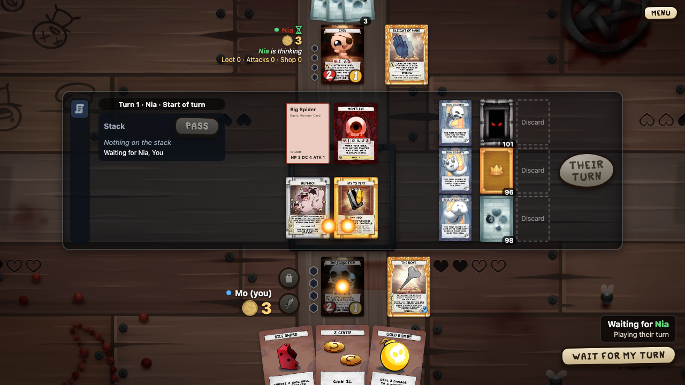
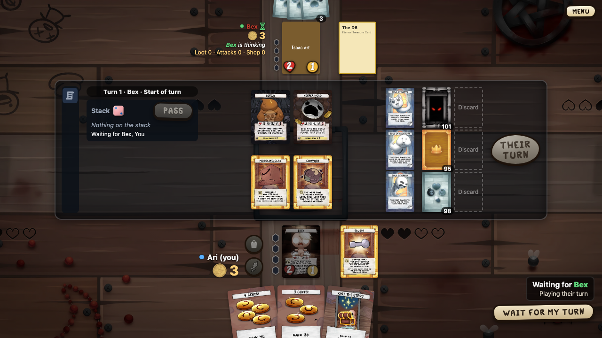

# Animations

Every animation in the client, what starts it, and which card it owns. The decision behind these rules is ADR 012; the code that checks them is `frontend/src/animations.ts`.

## The rules

1. **One card, one animation per job.** A card gets one arrival on the table per update, and is shown large once. Two animations that bring or show the same card *clash*; that was 19.3, 19.4 and 19.6.
2. **Events own the animation; the view follows.** Playback plays an update's events as effects, then draws the update's view (see [Client](Client)). An effect that brings a card to its place *claims* it. When the view then draws that card, it does not animate it again: `Card`'s pop-in only plays for cards no effect brought.
3. **Every animation is listed here.** Each animation in the code has an `anim: <id>` comment on the line above it (`<motion.*>`, `.animate(`, `@keyframes`). Each id has one row in the table below. The Vitest test `animation inventory` (`animations.test.ts`) fails when a site has no tag, or when the code and this table disagree.
4. **A new animation that brings or shows a card claims it.** Map its effect in `claimEffect`, or call `claim(card, job, id)` before it starts. A clash is logged as `animation clash: …` in the console, kept in `clashes`, and the second animation is skipped.
5. **Every e2e test fails on a clash.** Specs import `test` and `expect` from `e2e/tests/fixtures.ts`, not from `@playwright/test`. Its automatic fixture reads `window.fourSouls.clashes` on every page after each test.
6. **Removing or replacing an animation removes its row and tag.** The inventory test makes a leftover row fail.

## Beats and jobs

Claims are counted in *beats*: a beat is one update, from the start of its effects until the next update's effects start. It covers the cards the update's view mounts, so a pop-in sees the effect that brought its card.

| Job | Means | Clashes with |
|-----|-------|--------------|
| `arrive` | The card comes to its place on the table: a hand, a slot, a discard pile. | Another animation's `arrive` of that card in the same beat. The same animation may claim again (two copies of a card). |
| `show` | The card shows large in the middle of the screen. | Any `show` of that card in the same or the previous beat (19.4). |

## Inventory

Two animations as the player sees them: damage flies from each source to its target, and a dying monster shows a skull.

| ID | What it does | Why: what the player learns | Direction | Started by | Claims | Code |
|----|--------------|-----------------------------|-----------|------------|--------|------|
| `card-pop` | A table card scales and fades in when it first appears. | A card is new on the table. | In place: grows from 60 % where the card sits. | The view draws a `Card` with a new `objectId`. | Nothing; stays still when the card is claimed `arrive` this beat (19.6). | `components/Card.tsx` |
| `fly` | A card flies from one zone to another. As a `place` effect it stays on the slot until the view is drawn (19.3). | Where a card went: who gained a treasure, what was thrown away, which card filled a slot. | `discarded`: the card's spot on the table, else the player's hand, else its deck → that kind's discard. A dead monster (`discarded` or `gained_soul` whose `prev` is the held object of a `died`): the slot it died in, taken from the view before its death and kept across updates (`diedAt` in the store) → its discard, or the player who gains its soul; after its `death-skull`, and its slot shows empty meanwhile (`lifted` in the store, 19.73). Another `gained_soul` with `prev` (Holy Chest): `obj-<prev>`, if drawn → the player; a bonus soul has none. A gained treasure (18.9): `gained_treasure` from the treasure deck → the player's panel, except a starting or a stolen item; `purchased` from the shop slot the card topped on screen → the player's panel, and the slot shows empty meanwhile (`lifted`); a deck-top buy flies as its `gained_treasure`. Each plays the treasure sound. A gained soul with `prev` plays the soul sound (`soulGain`, `soul-gain.mp3`). A bonus soul (`text` `bonus soul`) flies from its card on the board, `obj-<id>` in the view before, with the same sound (18.13). A Lost Soul (type `Lost Soul Card`) becomes a soul in play: a `sound` effect plays the same sound and holds a beat, with no flight (18.14). `place`: the kind's deck → the monster or shop slot; none for an uncovered card (`card_revealed` with `prev`), which only pops in place (`card-pop`, 19.72). Right after a held `reveal`: from the middle, large, shrinking to a table card (15.73). A loot card leaving the stack (`discarded`, text `stack`): from the large card under the stack, at its size, else its stack row → the loot discard; the large card hides meanwhile (15.74). From then on the large card and the stack row stay hidden until the view is drawn (`left` in the store, 19.41). | `discarded`, `gained_soul` with `prev`, `gained_treasure`, `purchased` (`fly`); `card_revealed` of a slot's new top card (`place`). | `arrive` of the card, as `fly` or `place`. | `components/Effects.tsx` (`Fly`) |
| `loot-draw` | A looted card is drawn (20.7, ADR 027 "Draw"). The viewer's own card rises from the deck, turns face up and grows on its way to the show spot (1 s, expo-out), holds there a moment, then goes into the hand (0.5 s, expo-in): 1.5 s in all. Another player's flies from the deck to their hand, back up, in 0.8 s (quart-in-out). From a player's fourth draw in one update on, each is 11 % faster, down to 0.556 of its time (`drawPace`). Each card is its own effect, so one is in the air at a time. Sounds: `loot-draw` as an own card leaves and `loot-land` as it lands; `loot-draw-other` for another player's. The own card's hand card takes no pointer for 0.3 s after it lands. Reduced motion: an own card shows at the show spot and fades; another player's only sounds. | Which loot card the player just drew, before it joins the hand; that another player drew, and how many. | Own: loot deck (or loot discard) → up a little → the show spot, a little above the window's middle → the player's hand. Another player's: loot deck (or discard) → their hand, else their panel. | `looted`. | `arrive` of an own card; nothing for another player's, whose card is never seen. | `components/Effects.tsx` (`Draw`), `draw.ts` |
| `reveal` | A card grows out of its deck and shows large in the middle (15.73). | Which card just turned up, so everyone can read it. | Its deck → the middle. Then: held in the middle when its next effect moves it; else back onto its deck, shrinking. No deck on screen: fades in and out in the middle. | `card_revealed`, unless the update before revealed it (19.4). | `show` of the card. | `components/Effects.tsx` |
| `dice` | A changed roll's die spins in with the old value, takes the `roll-shot`, and turns to the new value; the label "Ann's roll: 3 → 4" is in the roller's color (15.76). | A roll was changed, by which card, from what to what. | Middle of the screen; spins in from 40 %, a full turn when the shot lands. Without an old value it shows the new one only. | `roll_changed`. | Nothing. | `components/Effects.tsx` (`ChangedDie`) |
| `dice-throw` | The thrown die, a 3D cube (`DieCube`, 15.69), falls from above, bounces twice and tumbles to rest with the engine's value on top, seen from above (15.82); its shadow grows on the table, and its label fades in after the landing (15.62). A roll of several dice (`dice`) throws them all side by side, at small uneven gaps (`diceDelays`), each with its own clatter as it lands (19.39). | A die was thrown, and the value it landed on. | Middle of the screen, where the Throw button waited; straight down from above the screen. | `dice_rolled`: a fresh roll or a reroll. | Nothing. | `components/Effects.tsx` (`ThrownDie`) |
| `banner` | A text banner in the middle. A start-of-game banner (`long`) stays twice as long (15.43). A turn's start has its own, `turn-banner` (20.8). | Who won; a tie in the first-player roll; who goes first and why. | Middle of the screen; fades in place. | `game_won`; `first_roll_tied`, `first_player` (long). | Nothing. | `components/Effects.tsx` |
| `popup` | A short "+N" text rises from a zone. | A player gained or stole cents; a card or player healed; damage was prevented. A steal also shows the victim's loss. | Rises up from the receiver: the player's panel (cents), else the healed or protected card. A steal: "−N¢" on the victim's coins, then "+N¢ stolen" on the thief's when the `coin-shot` lands (15.75). | `gained_cents`, `healed`, `prevented`, `stole`. | Nothing. | `components/Effects.tsx` (`Popup`, `Steal`) |
| `lunge` | A fast strike (20.2, ADR 027): a copy of the attacker lifts and grows (0.25 s); it and a copy of the target meet half way (0.12 s, linear); both settle home (0.5 s, expo-out). The cards hide meanwhile. Reduced motion: no strike, only the `burst`. The contact sound follows the hit's size (20.3): `attack-hit`, `attack-hit-2`, `attack-hit-3`. | Who attacks whom in a fight, and the moment the hit lands. | Attacker's card, drawn back a little → the meeting point ← target card; then both back. A target that is no card (a player's panel) stays; the attacker goes all the way, short of its centre. | `damaged` with `text: "combat"` and a `source`. | Nothing; it moves a copy. | `components/lunge.ts` |
| `burst` | A starburst "−N" on a damaged card, in three sizes by the damage (20.3): 1; 2–3 is larger with a gold glow; 4 and more larger still with a wide glow. The damage number that stays (20.4, ADR 027): it grows from 0 with an elastic overshoot (1 s), starts to fade at 2 s and is gone at 3 s. Playback never waits for it: the next effect starts as it shows. Several on one card stack, one burst height apart: middle, above, below, two above, … (`stackSpot`). Reduced motion: no growth; it shows at full size and fades. | Which card took damage, how much, and how hard it hit; it stays readable while the game goes on. | In place, on the damaged card (or the player's character); a stacked one above or below it. | The contact of a `lunge` (the strike's end), or the hit of a `hit-shot`. | Nothing. | `components/lunge.ts` (`burst`) |
| `hit-shake` | Table cards near a hit are pushed away from it and settle back (20.3, ADR 027). The push grows with the hit's size: 0.1, 0.5 or 1 of its full reach. Speed "off" and reduced motion: none. | How hard the hit was; the table feels the blow. | In place: each card within reach moves straight away from the hit's centre, swings back a little past home, and stops. | The `burst` of a `lunge` or a `hit-shot`. | Nothing; the card stays in its place. | `components/shake.ts` |
| `table-shake` | The whole table jitters briefly, fading out (20.3, ADR 027). Speed "off" and reduced motion: none. | A blow that killed: a lethal hit, or a player's death. | In place: small random offsets of the table that shrink to nothing. | A lethal `burst` (the target has no HP left, or died in the same update); the `death-skull` of a player. | Nothing; not a card. | `components/shake.ts` |
| `hit-shot` | A glowing shot flies from a damage source to its target. | Where damage outside a fight came from, and what it hit. | Source card on the table, else the large played card, else its stack row, else the dealing player's character, else their area → the damaged card (15.77). None on screen (a monster's card that left): no shot, only the `burst`. | `damaged` without combat (`hits` effect). | Nothing. | `components/marks.ts` |
| `death-skull` | A big skull pops on a dying card. | Which card died. | In place, on the dying card. | `died` (`deaths` effect). | Nothing. | `components/marks.ts` |
| `end-turn-glow` | A green halo behind End turn breathes by opacity (19.76). Stronger since 20.10 (ADR 027 "End Turn button"): the button itself turns green, the halo is larger and breathes from 55 % to full, 1.6 s each way, and brightens on hover (a CSS transition, 0.15 s). Speed "off" and reduced motion: it stands still. | Nothing is left to do; end the turn. | In place, behind End turn. | CSS class `.end-turn-slot.idle`: the look `done` (`endTurnLook`). | Nothing; not a game event. | `components/Actions.css` |
| `aim-march` | The aiming arrow's blocks march toward its head. | Which way the play goes: from the card to its target. | Along the arrow: the played card → the arrow's head at the pointer. | Aiming a card (15.32). | Nothing; not a game event. | `components/Table.css` |
| `aim-fade-in` | The arrow's first block fades in, in step with the march. | None of its own; keeps the march seamless. | In place, at the arrow's tail by the card. | Aiming a card. | Nothing; not a game event. | `components/Table.css` |
| `aim-fade-out` | The arrow's last block fades out, in step with the march. | None of its own; keeps the march seamless. | In place, at the arrow's head. | Aiming a card. | Nothing; not a game event. | `components/Table.css` |
| `aim-why` | The hint under an invalid aim fades out. | Why that click does nothing; it leaves by itself. | In place, just above the pointer. | Aiming at a card that is not a target; a click on a card or turn icon the player can't use now (15.29). | Nothing; not a game event. | `components/Table.css` |
| `hand-glow` | The green aura behind a playable hand card breathes slowly. | This hand card can be played now. | In place, behind the hand card. | CSS class `.hand-card.usable` (15.27). | Nothing; not a game event. | `components/Table.css` |
| `prompt-glow` | The gold glow behind the prompt banner, and behind Pass when passing answers it, breathes. | The game waits for you; Pass answers it. | In place, behind the banner and Pass. | A prompt for the viewer (15.28). | Nothing; not a game event. | `components/Actions.css` |
| `board-my-move` | A green halo around the board fades in late, pulses once, then stays soft (15.95). | The game waits for you: you hold priority or must answer. | In place, around the board. | CSS class `.board.my-move`: a prompt for the viewer, not while aiming, picking or paused. | Nothing; not a game event. | `components/Table.css` |
| `throw-glow` | The halo behind the roller's Throw button breathes. | It is your roll: press Throw. | In place, behind Throw in the middle. | A throw prompt for the viewer (15.61). | Nothing; not a game event. | `components/Throw.css` |
| `throw-shake` | The roller's die shakes in their hand while the others wait. | Another player is about to roll; wait. | In place, in the middle where the die will land, under the roller's name. | A throw prompt for another player (15.61). | Nothing; not a game event. | `components/Throw.css` |
| `played` | Another player's loot card rises from their hand, shows large in the middle with "Ann plays", then goes on the stack (15.31, H-10, 15.74). Paced since 20.9 (ADR 027 "Others' plays"): it rises and grows in 1 s, expo-out, and plays `card-play-other` as it shows. Playback goes on 1 s after it shows: the update's view is drawn and the next effects play while it stays. At 3 s it shrinks into the stack panel (0.4 s); its label fades first. A newer big card, any later effect in the middle (`reveal`, `dice`, `banner`, `turn-banner`, an own `loot-draw`) or a move of the same card sends it away at once (`playedEnds`). Reduced motion: it fades in and out in the middle. The viewer's own play has none; a viewer without a seat sees every play. | Which loot card another player played; it stays readable while the game goes on. | The player's hand (else their panel) → the middle → the stack panel, shrinking to a hand card; the label fades before it leaves. No stack panel then: it fades in the middle. | `loot_played` by another player, or by anyone for a viewer without a seat. | `show` of the card. | `components/Effects.tsx` (`BigPlayed`) |
| `coin-shot` | A coin flies in an arc from one player's coins to another's (15.75). | Who lost the cents and who took them. | The victim's coin counter → the thief's, growing at the top of the arc; it fades as it lands. | `stole` with the victim in its text. | Nothing. | `components/Effects.tsx` (`Steal`) |
| `roll-shot` | A cool blue shot flies from the card that changes a roll to the die (15.76). | Which card changed the roll. | The source card on the table, else its stack row → the changed die in the middle. No source on screen: no shot. | `roll_changed` with a `source`. | Nothing. | `components/Effects.tsx` (`ChangedDie`) |
| `sky-drift` | The night sky and its five star layers drift slowly behind the menu screens; the nearer stars faster (15.42, V-35). | Nothing about the game; the menus feel alive, like foursouls.ru. | Down and to the left, one tile per loop: the sky in 120 s, the star layers in 30 s to 10 s. | The home, welcome, settings, host, join and table screens, with the images. | Nothing; not a game event. | `components/Sky.css` |
| `row-move` | A stack panel or history strip row fades in when it comes, slides to its new place when others come or go, and fades out when it leaves; then the rest close the gap (15.51, V-39). | Which item is new and which one just resolved; the list never jumps. | In place, in the list: fades in and out where the row sits; other rows slide up or down. | A new or a removed stack item, open declaration, or history headline, once the view is drawn. | Nothing; the row is not the card. A leaving row has no zones, so no effect starts or lands on it. | `components/Rows.tsx` |
| `source-icon` | An effect icon on a character or monster fades in when it comes; at the end of the turn it shrinks and fades; a next-roll icon used by the roll pops and fades (15.93, SB-12, SB-13). | Which effects of this turn change the card, and when they end or get used. | In place, on the card's right edge: grows from 40 % in; shrinks to 50 % at the end of the turn; grows to 180 % when used. | A new or a removed source of this turn in the view (`tempSources`), once the view is drawn. | Nothing; the icon is not the card. | `components/Card.tsx` (`SourceIcon`) |
| `menu-group` | The main menu's Play group grows open under Play and fades in; closing shrinks it away (15.96, M-06). | Play holds LAN, Online and Learn to play. | In place, under Play: grows down from 0; the buttons below slide down; the ones above stay put. | A click on Play; a second click or Esc closes it. | Nothing; not a game event. | `screens/MainMenu.tsx` |
| `card-flip` | A two-sided card on the table turns edge-on, shows its other side, and turns back to the front (ADR 023). | The card changed side: its name, text and stats are now the other face's. | In place: turns about its vertical axis, 90° out with the old face, 90° back in with the new one. | The view draws a `Card` whose `objectId` stays and whose card turns to its other face (`back` or `front` in the card list). A rollback's table only jumps. | Nothing; the card stays where it is. | `components/Card.tsx`, `components/Card.css` |
| `zoom-grow` | A hovered table card's zoom grows out of the card (20.5, ADR 027 principle 2): it waits 0.4 s, then scales from the card's size to full in 0.15 s, expo-out. A hand card's zoom shows at once, with no growth. While a zoom shows, or within 0.3 s after one closed, the next card's shows at once, with no growth. Speed "off" and reduced motion: no growth; the wait stays. | Which card the pointer rests on; a pointer passing over the table opens nothing. | From the hovered card's middle out to the zoom's place beside it. | A mouse resting on a table card, a soul crystal or a card in a window (`useZoom`). | Nothing; the pointer's answer, not a game event. | `components/CardZoom.tsx` |
| `drag-tilt` | A dragged hand card tilts by its own motion, as if held in a hand (20.6, ADR 027 "Drag"): each move leans the edge it moves toward away from the player, up to 40° pitch and 45° roll; held still, it springs back to flat in about 0.2 s (a smooth-damp, `tiltStep` in `drag.ts`). Its green aura tilts with it. Two loops follow the drag: `drag-bed` fades in, `drag-air` grows with the speed; both fade out on the drop. Speed "off" and reduced motion: no tilt; the loops still play. | The card is in the player's hand, and how fast it moves. | In place on the dragged card: its inner box turns in 3D about its middle; the drag's own move stays apart. | Dragging a playable hand card (`HandCard`, `holdCard` in `dragFeel.ts`). | Nothing; not a game event. | `components/PlayerArea.tsx` |
| `turn-banner` | A new turn's banner, "Ann's turn" (20.8, ADR 027 "Turn start"): it fades in as it grows from 10 % to full size (0.25 s, expo-out), punches down to 98 % (0.15 s), and at 1.5 s shrinks back and fades (0.25 s). As it shows, the turn's recharge lights the player's spent character and items (`charged` in the store), before the view is drawn. Playback goes on after 1 s: the turn's draw and the rest of the update play while it still shows. It is visual only: no pointer, no input lock; a click on a live button works as always. The viewer's own turn plays `turn-start`. Reduced motion: it only fades in and out. Speed "off": none, as every effect. | Whose turn starts, and that their cards are ready again. | Middle of the window, in the effect layer above the effects; grows and shrinks about its middle. | `turn_started` (`turn` effect); the charges when the same update has the player's `recharged`. | Nothing; not a card. | `components/turn.ts` |
| `count-flip` | A counter counts (20.11, ADR 027 "Counters"): the cents of every player, the soul crystals, and the health badges of characters and monsters. A change of N plays as N steps, 0.2 s apart, the first at once; more than 5 steps speed up to fit 1 s (`countTimes`). Each step flips the new number in about its horizontal axis in 0.1 s, expo-out: from above when it grows, from below when it falls; a crystal flips as it fills or empties. A change while it counts goes on from the number on screen. Speed "off" and a rollback's table: the number jumps. Reduced motion: it still counts, with no flip. | How much a counter changed, one step at a time, not only the result. | In place: the number, or the crystal, turns in where it sits. | A new view whose cents, souls or health differ from the number on screen (`Count`, `useCount`). | Nothing; a number, not a card. | `components/Count.tsx` |
| `others-hold` | Another player's hand, live (20.13, ADR 027 "Other players live"). A hand card they hover on their turn lifts its back 14 px toward the table in 0.15 s, expo-out (a CSS transition). A card they drag floats its back 56 px out of the fan and grows to 1.15× in 1 s, expo-out, then sways ±3° about the fan's pivot, 10 s per side (`@keyframes others-sway`), until it is played or put back. The back stays a back; it comes over the player's own character. Times in `feel.others`, set on `.hidden-hand` (`Pile.tsx`). Speed "off" and reduced motion: the back moves at once, with no sway. | What another player is about to do: which card they look at, and that they hold one to play. | In place in their hand: the back moves straight toward the table, then swings about the fan's pivot. | A `presence` from another seat: `at` a hand slot with no `from` (hover), or `held` (`marksOf` in `presence.ts`). | Nothing; not a game event. | `components/Table.css`, `components/Presence.tsx` |
| `timer-fuse` | The response timer's fuse (20.15, ADR 027 principle 9). The timer shows only in its last 20 s: the seconds after the prompt's title, and a fuse along the prompt's foot that burns down, linear, to empty at the deadline (`feel.timer`). Each second it then loses ticks (`timer-tick`), and 0 ticks `timer-last`, for the player it waits for only. It is a clock: the animation speed does not scale it, and the ticks play with speed "off" too. Speed "off" and reduced motion: the fuse steps once a second. | Time is running out; how much is left. | In place: the fuse shrinks toward the seconds, at the prompt's right. | `update.deadline` 20 s or less away (`ResponseTimer`, `timerShows` in `timer.ts`); a new deadline starts a new fuse. | Nothing; not a game event. | `components/Actions.css`, `components/ActionBar.tsx` |

## Times and curves

Every time and easing curve of the table's motion lives in `frontend/src/feel.ts` (20.1, ADR 027): `feel` holds each motion's time in seconds at normal speed and its parts as fractions of it (today `lunge`, `burst`, `fly`, `banner`, `hit` and `table`; the lunge's phases are each in seconds since 20.2), and `curves` the easing curves as CSS strings: `linear`, the CSS keywords, `expoOut` and `sineInExpoOut` (the reference's draw path, which runs as expo-out). WAAPI keyframes take a curve as it is; motion takes `bezier(curve)`, which also throws on a string CSS would not take. CSS has no elastic curve, so elastic-out is a keyframe list, `elasticOut` (`elastic(t)` sampled in 30 straight steps, value 0 → 1 with the overshoot). `feel.test.ts` checks that every curve parses. A new motion takes its times from there, not from a number in a component. Since 20.3 `feel.hit` also holds a hit's size by its damage (`hitSize`: 1, 2–3, 4 and more) and what each size does: the burst's scale, the push of the cards near it, the reach of that push; `feel.table` holds the table's shake on a lethal hit or a player's death. Since 20.4 `feel.burst` is the damage number's life: `grow` (its elastic-out growth, from `elasticOut`), `hold` (when its fade starts, counted from its start, as in the reference) and `fade`, and `stack`, the gap between stacked bursts in burst heights. Since 20.5 `feel.hand` is the own hand's fan (`fanPose`: straight below 4 cards, then 40° plus 2° per card, ends dropping on the reference's parabola) and `feel.zoom` the hover zoom: `delay` for a table card, `grow` and `growCurve`, and `grace`, how long after a zoom closes the next card's still shows at once. Since 20.6 `feel.drag` is a held card's tilt and loops: `gain` degrees per `unit` px moved, up to `pitch` and `roll`, back to flat over `rest`; `perspective`; the loops' mixer gains `bed` (fading in over `bedIn`) and `air` (the air's level from the speed: `airScale`, `airBase`, `airEase`, `airRate`), and `out`, their fade on the drop. Since 20.7 `feel.draw` is a drawn loot card: its legs `show` and `hand`, its turn face up (`turnAt`, `turn`) and growth (`growAt`, `grow`), the `lift` of its rise, the show spot (`spotX`, `spotY`, `spot` px wide), `ready`, how long its hand card waits for the pointer, `other`, another player's draw, and the speed-up of repeats (`fastFrom`, `faster`, `fastest`, `drawPace`); `curves` gained `expoIn` and `quartInOut`. `draw.ts` samples a pose at a time, so one clock drives the move, the turn and the size. Since 20.8 `feel.turn` is a new turn's banner: `grow` from `from` with `curve`, the `punch` over `punchTime`, `hide`, when its fade starts, counted from its start, `out`, and `wait`, when playback goes on. Since 20.9 `feel.played` is another player's big played card: `rise` and `riseCurve`, `wait`, when playback goes on, `stay`, when its leave starts, both counted from when it shows, and `leave` and `leaveCurve`. Since 20.10 `feel.endTurn` is End turn once nothing is left: `cue`, the wait before its voice cue, the halo's `breath` and `low`, and its hover glow, `hover` over `hoverTime` with `hoverCurve`; the component sets them on the slot as CSS variables. Since 20.11 `feel.count` is a counter that counts: `step`, the gap between steps, `fit`, the most a whole count takes, and the flip of each step, `flip` and `turn` degrees with `flipCurve`; `countTimes` gives each step's start. Since 20.12 `feel.catchUp` is how a lagging client catches up (`catchUp` in `playback.ts`): from `dropMinor` waiting updates minor effects are dropped, from `shorten` (or `burst` effects in one update) the rest play at `short` of their time, and from `dropNormal` only key effects play (`weightOf`: a player's death, a soul, the game's end, the viewer's own turn start). No animation changes its look; fewer of them play. Since 20.13 `feel.others` is what other players do, live: `sample` and `aimSample`, the gaps between presence messages; `follow`, how much of the way an arrow head closes per 60 fps frame (`followStep`); a hovered back's `hoverLift` over `hover` with `hoverCurve`; a held back's `holdLift` and `holdGrow` over `hold` with `holdCurve`; its `sway` degrees, `swayTime` per side, with `swayCurve`. Since 20.14 `feel.mix` is the sound mixer, not a motion: `gap`, the playback limit of one sound, and the duck of every other sound while a key cue plays: down to `duck` over `duckIn`, back over `duckOut`, both linear, `cueMax`, the longest a cue counts as playing, and `tick`, how often the mixer moves its gain. The animation speed neither scales nor stops them.

CSS `transition`s on hover and focus are not listed: they answer the pointer, not the game, and cannot clash with an effect.

A rollback (ADR 020, item 8.5) has no animation: its update plays no effects, and while its table shows, `viewScale` is 0, so no card pops in, no effect icon fades and no row slides. The table jumps to the restored view; the next update animates as usual.

## Adding an animation

1. Pick an id; add the `anim: <id>` comment above the animation in the code.
2. Add its row to the table above, with its Why and Direction.
3. If it brings a card to its place or shows it large, claim the card (`claimEffect` or `claim`).
4. If it replaces an older animation for the same event, remove the old one with its tag and row.
5. Add an e2e test that plays it; the clash fixture then checks it with every other test.
