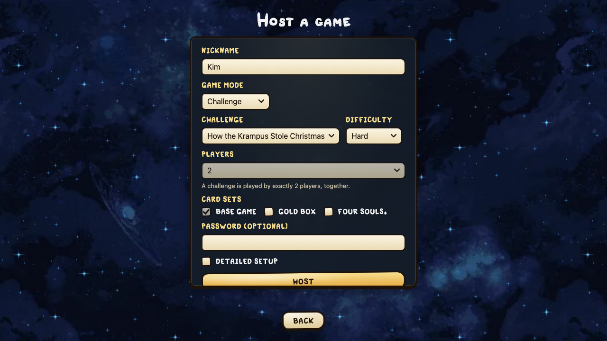
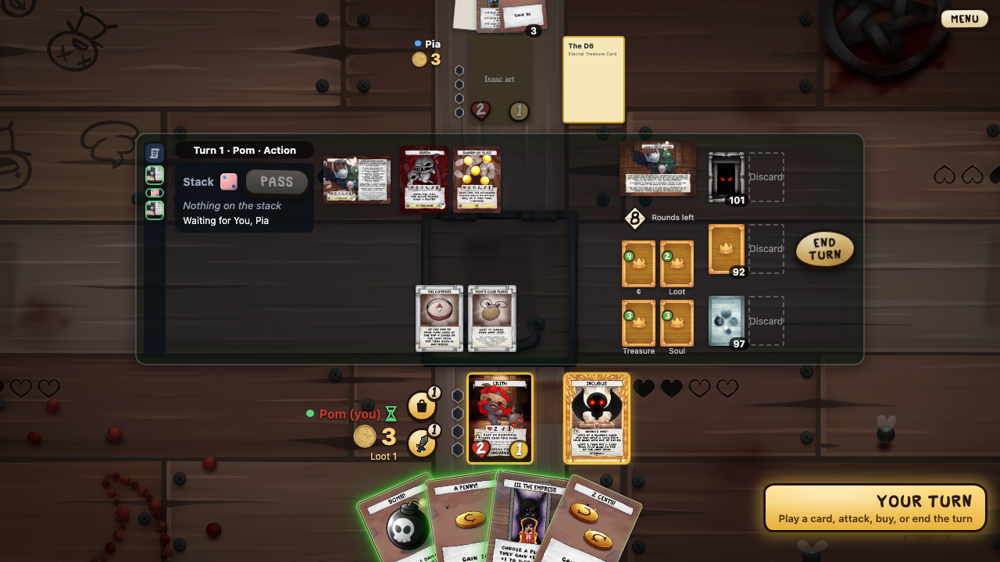
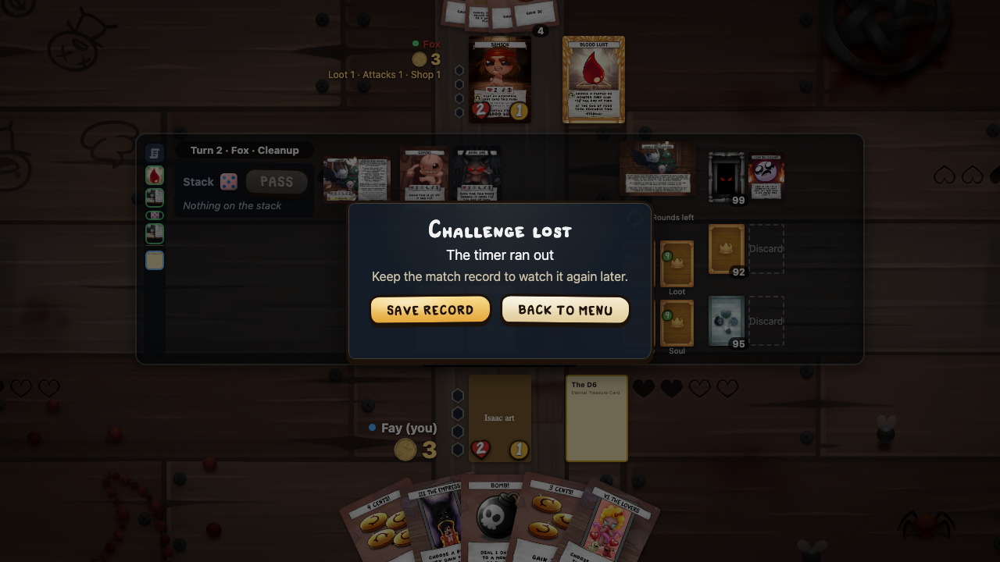

# Challenges

A challenge is a co-op game: two players play together against the game itself. There is no race for souls. Both of you win together, or both of you lose together. The official challenges come from Maestro Media; this app has two so far, **How the Krampus Stole Christmas** and **Trick or Treat**, each at three difficulties.

The rules the app follows are in the rules file `challenges.md` (topics COOP, CHAL, KRAMPUS and TRICK) on the rules website. This page tells them in short.

## Host a challenge

1. **Play → Host** (or **Create** on a server), as for a regular game.
2. Set **Game mode** to **Challenge**. It sits above the players in the simple setup.
3. Two more selects appear beside it: the challenge (How the Krampus Stole Christmas or Trick or Treat) and its **difficulty**: Normal, Hard or Ultra Hard.
4. **Players** locks at 2. A challenge is for exactly two people, one character each.
5. Press **Host**. The game list shows "Challenge: How the Krampus Stole Christmas" and the difficulty, so your friend knows what they join.

**Detailed setup** keeps every option of a regular game (card sets, draft, timer, rooms, rollback), except bonus souls: a challenge plays without them. The host screen remembers the mode, challenge and difficulty for next time.

A server that is older than your app may not know the challenge; it then refuses the game with a message.

## Co-op rules

* Each of you keeps your own cents, hand and souls; nothing is shared, and you can't give each other cents.
* You see your partner's hand, so you can plan together.
* Cards marked for 3 or more players are left out, as in any 2-player game.
* Collecting 4 souls does not win the game, and neither does a card that says "you win". Only the challenge's goal does.
* **Timer**: a d8 starts at 8 and goes down by 1 at the end of each round, after both of you had a turn. When it reaches 0, you both lose. A death does not move it.
* With rooms in play: a room that sat unchanged for a whole round goes away, and a new one takes its place.

## How the Krampus Stole Christmas

Pilfering Krampus has stolen four presents. Get enough souls, clear his minions, and kill him before he destroys them all.

**Goal.** You win when Pilfering Krampus dies. You lose when all four presents are destroyed, or when the timer runs out.

**Pilfering Krampus** sits in his own **final boss** slot, left of the monster slots. He has 4+ evasion, 2 attack, and 5 HP on Normal or 6 HP on Hard and Ultra Hard. He never leaves his slot unless he dies, and big non-combat hits on him are capped at 3 damage (a card that would just kill him deals 3 instead). You can only attack or hurt him when:

* you hold enough souls between you: 5 on Normal, 6 on Hard, 7 on Ultra Hard; and
* no minion is left on the table.

**Presents.** Four treasure cards lie face down beside the table: the ¢ present, the loot present, the treasure present and the soul present. Each starts with counters:

| Difficulty | ¢ | Loot | Treasure | Soul |
|---|---|---|---|---|
| Normal | 8 | 2 | 3 | 3 |
| Hard | 12 | 4 | 3 | 3 |
| Ultra Hard | 16 | 4 | 3 | 3 |

At the start of every turn the active player rolls for Krampus, and the roll takes counters off one present: mostly the ¢ present on low rolls, the soul present on a 6. On Hard you roll once more for every two minions on the table; on Ultra Hard, once more for each minion.

**The three global rules** (on the challenge card):

* **What's in the Box?** A present at 0 counters is destroyed. Then minions come: the top 3 cards of the monster deck on Normal, 4 on Hard and Ultra Hard, each into a new minion slot under the monster slots. A minion is a monster, but killing it gives no reward and no soul. A minion slot is never refilled; it goes away with its card. An event that comes up as a minion just happens and is gone.
* **All I Want for Christmas.** When you would gain a monster's reward or a soul, you may give it up and put that many counters on the matching present instead: cents on the ¢ present, loot on the loot present, treasures on the treasure present, a soul's value on the soul present. The app asks you each time.
* **Happy Holidays!** The first time you hold enough souls between you (5, 6 or 7, as above), every present still there turns face up and becomes an item. The active player picks who gets each one.

**Normal only**: while a minion is on the table, the active player must attack a random minion once each turn, if they can. When you attack, the game picks the minion for you.

The regular Krampus monster from Four Souls+ can still turn up in the monster deck; he is a different card.

## What the table shows

* **Pilfering Krampus** lies sideways left of the monster slots. While he can't be attacked, he stays dim when you pick an attack target.
* **Minions** lie in a row under the monster slots; the row is empty until the first present is destroyed.
* The **challenge panel** stands where the bonus souls would be:
  * the challenge card of your difficulty, sideways; it zooms like any card;
  * the timer, a d8 with the rounds left (hover it for the count);
  * the four presents, face down, each with its kind under it and its counters on it. A destroyed present's place shows ✗, a given one's ✓.
* When counters come off or go on, a "−N" or "+N" rises from the present.
* The history names every roll, destroyed present, minion and timer tick.
* At the end both players see **Challenge won!** or **Challenge lost**, with the reason under it (the presents are gone, or the timer ran out). The game record is saved as for any game.

Without the card images, the boss, the challenge card and the presents show as text cards, like every other card.

## Trick or Treat

Mischievous The Haunt is out to scare you. Kill enough monsters to wear down its tricks, keep your nerve, and kill it before the timer runs out.

**Goal.** You win when Mischievous The Haunt dies. Nothing else loses this challenge; only the timer does.

**Mischievous The Haunt** sits in the final boss slot, left of the monster slots. It has 4 HP, 5+ evasion and 1 attack on every difficulty; killing it gives +1 treasure and a soul worth 1. It starts with **trick counters**: 12 on Normal, 14 on Hard and Ultra Hard.

**The guard.** While the Haunt has more trick counters than the souls you hold between you, nobody can attack it or hurt it. So the plan is to bring the two numbers together: kill monsters to take trick counters off (on the Trick side, below), and collect souls.

**Fear.** Each time a player takes damage, that player gets a fear counter, one per hit whatever its size. On Ultra Hard every player gets one instead. Fear stays with the player, through a death too. For every 2 fear counters on the active player, every monster (the Haunt included) has +1 evasion, up to 6. Each time a monster dies, the active player rolls: on 4–6 they take a fear counter off a player of their choice, themselves included. With nobody afraid, nothing happens.

**The Trick/Treat card.** One two-sided card serves all three difficulties. It starts Trick side up, and only the side up works. As each turn starts, the active player may flip it; the app asks "Flip the challenge card to Treat?" (or "…to Trick?"). The side then holds for the whole turn.

* **Trick** side:
  * *Nobody's Fool*: each time a monster dies, the Haunt loses a trick counter.
  * *Ghostly Trickery*: as each attack on a monster starts, the active player rolls once; twice on Hard, three times on Ultra Hard. Each result lasts till the end of the turn:

| Roll | Trick |
|---|---|
| 1–2 | Damage the active player takes is 1 more. |
| 3–4 | Cards are revealed from the monster deck until a monster turns up; the attacked monster gains its abilities. The revealed cards go to the bottom. |
| 5–6 | The attacked monster's rewards become just 1¢. |

* **Treat** side:
  * *You Don't Scare Me*: each time the active player gains a monster's rewards, they take a fear counter off a player of their choice.
  * *Hallows' Eve Bounty*: as each attack on a monster starts, the active player rolls once (at every difficulty), and the attacked monster gives more till the end of the turn:

| Roll | Treat |
|---|---|
| 1–2 | +3¢ |
| 3–4 | +1 loot |
| 5–6 | +1 treasure |

So Trick moves you toward the Haunt but makes fights harder; Treat pays better and calms your fear, but the trick counters stay put. Same results stack: two 1–2 rolls on Hard make each hit 2 more.

**Difficulties** in short:

| Difficulty | Trick counters | Fear per hit | Trick rolls |
|---|---|---|---|
| Normal | 12 | on the player hit | 1 |
| Hard | 14 | on the player hit | 2 |
| Ultra Hard | 14 | on each player | 3 |

The regular The Haunt from the Base Game can still turn up in the monster deck; it is a different card.

### On the table

* **Mischievous The Haunt** lies in the final boss place with its trick counters as a counter badge. While it is guarded, it stays dim when you pick an attack target.
* The **challenge panel** shows the Trick/Treat card with its side up, and the timer. There are no presents. A flip turns the card over in the panel.
* **Fear** shows by each player's name: a dot, the number and the word "Fear". Hover it to read what it does.
* Monsters show their raised evasion; the zoom names the Haunt as the source.
* An attack on a monster starts with a **Throw** for the side's roll, before the attack roll.
* Changed rewards show as a ribbon on the monster (for example "1¢ · 1 loot") and under its zoom as "Rewards this turn". A monster that gained another's abilities has the copy mark.
* When a monster dies on the Trick side, the Haunt's roll and Nobody's Fool come at once, so the active player picks their order in the trigger order dialog.
* The history names fear gained and lost, trick counters taken off, and each roll's result.
* At the end both players see **Challenge won!**, or **Challenge lost** with "The timer ran out".

Without the card images, the Haunt and both sides of the Trick/Treat card show as landscape text cards.

## Not yet

* Playing both characters alone (solo).
* The competitive Krampus, where 2–4 players race to kill him.
* The competitive Trick or Treat, where 2–4 players vote trick or treat each turn.
* The other official challenges.
