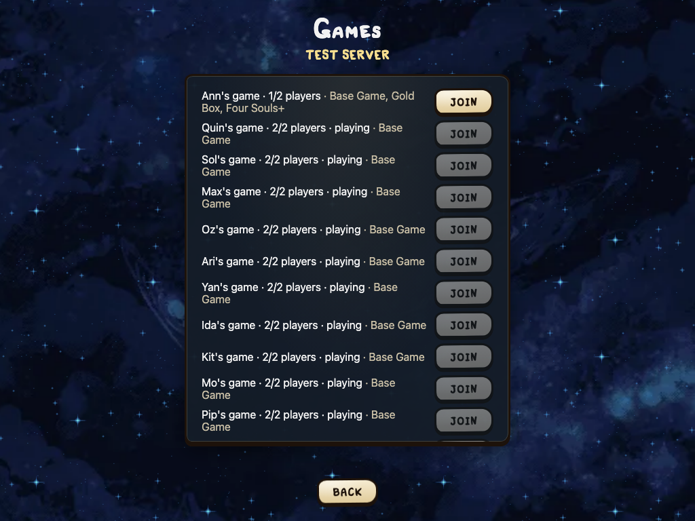

# Dedicated server on a VPS

Any player can rent a small server on the internet (a VPS) and run the game's dedicated server there. Friends then join its address from anywhere; nobody needs a virtual LAN or port forwarding (see [Playing over the internet](Playing-over-the-internet)).

This page has what every setup shares. Then pick one way to run the server:

| Setup | Good for | Players type |
|---|---|---|
| [Server as a systemd service](Server-as-a-systemd-service) | the smallest setup: one binary, no Docker | `1.2.3.4` or `games.example.com:4774` |
| [Server in Docker](Server-in-Docker) | a VPS that already runs Docker; one file to download | `1.2.3.4` or `games.example.com:4774` |
| [Server with Docker Compose and Caddy](Server-with-Docker-Compose-and-Caddy) | a domain with HTTPS: encrypted, players type only the domain | `games.example.com` |

## What you need

* A Linux VPS. The server is small: 1 CPU and 512 MB–1 GB of memory are plenty for a few games. Any provider works (Hetzner, DigitalOcean, Vultr, OVH, Linode, a local one); the cheapest plan is usually enough. Pick a location close to your friends.
* SSH access to it (the provider shows the address and the login).
* For HTTPS only: a domain (or a subdomain) whose DNS `A` record points at the VPS address.
* Everyone's app must speak the same protocol version as the server; using the same release is safest. Every setup below gets the server of the latest release.

## Downloads

Each release has server archives apart from the game, with no version in their names, for example `four-souls-server-linux-amd64.tar.gz` (or `-linux-arm64` for an ARM VPS). So this link always gets the newest server:

```
https://github.com/FourSoulsRepo/four_souls/releases/latest/download/four-souls-server-linux-amd64.tar.gz
```

The archive holds `four_souls_server`, a static binary that runs on any Linux distribution. The ready setup files live in the repository under `deploy/`.

## Open the port

The plain setups use **TCP port 4774** (or the one you chose); the HTTPS setup uses **80 and 443** instead. With `ufw`:

```sh
ufw allow OpenSSH
ufw allow 4774/tcp            # plain setups
ufw allow 80/tcp; ufw allow 443/tcp   # HTTPS setup
ufw enable
```

Many providers also have a firewall in their web panel; allow the ports there too. Docker publishes ports past `ufw`, so with Docker check the provider's firewall too.

## Play

Friends open the game, choose **Play → Online**, and type the server's address: the IP, or the domain (add `:4774` only for a port other than 4774 with a plain setup). A bare domain first tries a secure connection, then the plain port 4774 (ADR 017). One of them clicks **Create a game** under the server's games, sets it up and clicks **Create**; the others join it from the same list. Nobody needs to host in their app.

The Online screen marks each Recent server: a green dot and its open games when it answers, red when it is down.


Once connected, the Games list shows the server's games and open tables:



## Options

Every option is a flag, an ENV variable, or a value in a JSON config file. ENV overrides the file; flags override both. An empty ENV variable counts as unset.

| Flag | ENV | Default | Meaning |
|---|---|---|---|
| `-port` | `FOUR_SOULS_PORT` | 4774 | TCP port for players |
| `-addr` | `FOUR_SOULS_ADDR` | all addresses | listen only on this address |
| `-records` | `FOUR_SOULS_RECORDS` | `records` | where match records are saved (A-12) |
| `-retention` | `FOUR_SOULS_RETENTION` | 30 | days to keep records; 0 keeps them forever (RP-07) |
| `-saves` | `FOUR_SOULS_SAVES` | `saves` | where saved games wait to be continued (N-11) |
| `-presence` | `FOUR_SOULS_PRESENCE` | true | show others where a player aims and points; `false` saves CPU and bandwidth |
| `-name` | `FOUR_SOULS_NAME` | none | the server's name; players see it instead of the address, and records keep it (up to 40 characters) |
| `-empty_minutes` | `FOUR_SOULS_EMPTY_MINUTES` | 30 | end a game nobody is connected to for this many minutes; 0 never (N-20) |
| `-game_hours` | `FOUR_SOULS_GAME_HOURS` | 24 | end a game this many hours after it started, even while played; 0 never (N-20) |
| `-config` | `FOUR_SOULS_CONFIG` | none | a JSON file with the same settings |

```json
{"port": 4774, "records": "/var/lib/four-souls/records", "retention": 30, "saves": "/var/lib/four-souls/saves", "presence": true, "name": "Basement", "empty_minutes": 30, "game_hours": 24}
```

`GET /healthz` answers `ok` while the server runs; the Docker setups use it as their healthcheck.

## Updating

When the game gets a new release, players update their apps and you update the server; each setup page says how.

An update or a restart keeps the games (N-20, ADR 019). On stop the server tells the players it restarts and writes every table and game to `restart/` in the saves folder; the next start loads them, and the players' apps reconnect by themselves. Players see a short "Reconnecting…" note; a game goes on where it stopped once everyone is back.

* **Keep the saves folder** between the old and the new server: the same folder, or the same Docker volume. Without it the games are gone.
* **Same rules engine:** the games go on as if nothing happened.
* **Newer rules engine:** a game goes on if the new server reads it back exactly; its players are told that cards may now behave differently. A game it cannot read ends; its players get an apology, its record ends unfinished, and its file stays as `restart/<game>.fsrestart.lost` (the log says why).
* **Newer protocol:** players must update their apps before they can come back; the release notes say so.
* **A crash or `kill -9`** writes nothing: those games end, as before.

Games nobody plays do not live forever: one with no player connected for `empty_minutes` ends, and every game ends `game_hours` after it started. A server restart's downtime counts toward the first.

## Safety

* The game has no accounts. Anyone who knows the address can connect; share it only with your friends.
* The plain setups do not encrypt traffic (ADR 006). The HTTPS setup does: Caddy serves `wss://` (ADR 017).
* Keep the VPS updated (`apt update && apt upgrade` on Debian or Ubuntu), log in with SSH keys, and do not run the server as root. Every setup here runs it as its own user.
* Without a domain, for encryption put the VPS into the same Tailscale or ZeroTier network as the players, and do not open port 4774 to the internet at all.
