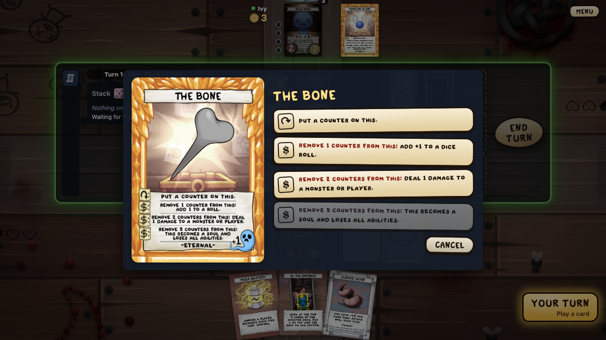

# Effect blocks

Cards are Go values built from small blocks (ADR 005). This page lists every block with a one-line example. For a step-by-step guide see [Adding a card](Adding-a-card).

```go
{Ref: "razor", Kind: TreasureCard, Abilities: []Ability{
    {Kind: Activated, Text: "Pay 5¢: Deal 1 damage to a monster or player.",
        Costs:   []Cost{PayCents(5)},
        Targets: []TargetSpec{Choose(TargetMonsterOrPlayer)},
        Effects: []Effect{DealDamage(1, 0)}},
}}
```

## Card definition fields

| Field | Meaning |
|---|---|
| `Ref` | Card ID, as in `card_db` (`the_d6`, `the_d6@2`) |
| `Kind` | `CharacterCard`, `TreasureCard`, `LootCard`, `MonsterCard`, `EventCard`, `BonusSoulCard`, `RoomCard` |
| `Copies` | Copies in the set |
| `HP`, `ATK`, `DC`, `Soul` | Stat box and soul value |
| `StartingItem` | A character's starting item |
| `Eternal` | Keyword: cannot be destroyed or discarded |
| `Outside` | Starts outside the game (starting items) |
| `Tap` | Has a ↷ ability (the death penalty deactivates it) |
| `Trinket` | Loot that becomes an item when it resolves (R-ABIL-19) |
| `Curse` | An event given to a player when it enters play (R-ABIL-20) |
| `Guppy` | The Guppy tag (R-ABIL-22) |
| `Unattackable` | "This can't be attacked." |
| `CombatMod` | Changes combat damage by attack roll: "This takes no combat damage on attack rolls of 6." |
| `BonusSoul` | A bonus soul's condition: "The first player to have 25¢ or more gains this soul." |
| `DamageMod` | Changes damage about to be marked: "Damage you would take is reduced to 1."; its `combat` flag marks combat damage ("Prevent all non-combat damage you would take": Callus) |
| `Attackable` | An item or room that can be attacked, with its own stats; killed, it is destroyed and its rewards and soul go to the active player (R-MECH-04, R-MECH-05: Punching Bag, Gus) |
| `GainsAbilities` | Cards whose abilities this object has too, computed: "This has the abilities of other items with gold counters on them" (Golden Trinket); `GainAbilities(id, card, till)` does it for a time (Glitch) |
| `Back` | A two-sided card's other face: a card defined in the same set with `Outside`; `Flip(id)` turns it, `WhenFlippedToThisSide()` triggers on it (R-MECH-33: Anima Sola, The Enigma, The Harbingers) |
| `Indomitable` | It can't be covered; put in a monster slot, it takes a new one (R-ABIL-23: Mega Satan) |
| `RewardsToKiller` | "The player who kills this gains its rewards", and its soul (Ultra Greed) |
| `OwnRechargeOnly` | "This can't be recharged except by its own abilities" (Car Battery); `RechargeSelf` still works |
| `InsteadOfDestroy` | Replaces this object's destruction and reports it did: "If this would be destroyed, if it has no counters on it, put a counter on it instead" (Bag Lunch) |
| `EntersDeactivated`, `EntersWithCounters` | "This enters play deactivated." / "starts with 9 counters" |
| `CopiesTapAbilities` | Placebo: may use any ↷ ability of another non-eternal item (`AbilitiesOf`) |
| `TakesPenalties` | Shadow: you choose the item and gain the loot and ¢ of others' death penalties |
| `PeeksTreasure` | "You may look at the top card of the treasure deck at any time on your turn" (in your view) |
| `SoulWhenDestroyed` | "If this would be destroyed, it becomes a soul instead." |
| `GoesFirst` | A character whose player goes first (Cain) |
| `StartingChoice` | Look at this many top treasures at the start, pick an eternal starting item (Eden) |
| `Dice` | Die numbers the card keeps, shown on it: a stored roll or a chosen number (Telepathy for Dummies, Red Candle); keep a chosen number in `Object.Chosen`, not in counters (Crystal Ball) |
| `Rewards` | Reward box, e.g. `[]Reward{{Kind: RewardCents, Amount: 3}}` |
| `Abilities` | Activated, loot and triggered abilities |
| `Statics` | Static abilities that change numbers |
| `Replacements` | Replacement effects ("instead", "prevent") |

## Ability kinds

A card with several abilities opens a dialog, where the player picks one:



| Kind | When it happens | Example |
|---|---|---|
| `Activated` | The controller uses it with priority, paying costs | ↷: Gain 3¢. |
| `LootAbility` | When the loot card resolves; targets are picked when it is played | Deal 1 damage to a monster or player. |
| `Triggered` | When its `Trigger` matches; goes on the stack at the next priority | At the start of your turn, gain 1¢. |

## Costs

| Block | Example |
|---|---|
| `Tap()` | ↷: deactivate the item (it must be charged) |
| `PayCents(n)` | Pay 5¢: … |
| `PayHPCost(n)` | Pay 1 HP: … (rooms: Blood Donation) |
| `DestroySelf()` | Destroy this: … (not on eternal objects) |
| `RemoveCounters(n)` | Remove 2 counters from this: … |
| `DiscardChosen(t)` | Discard a loot card: … (with `Choose(TargetYourHandCard)`) |
| `GiveChosen(item, player)` | Give an item you control to another player: … |
| `DestroyChosen(t…)` | Destroy 2 items you control: … (targets filtered with `NotChosen`) |
| `If(text, ok)` | A condition, not a payment: "if there are no cards under this" (Friendly Ball) |

## Targets

Targets are always asked, with a "cancel" option before anything is paid. A target that is gone when the ability resolves makes it fizzle.

| Block | Choose … |
|---|---|
| `Choose(TargetPlayer)` | a player; dead players too (damage to them is not marked) |
| `Choose(TargetMonster)` | a monster in play |
| `Choose(TargetMonsterOrPlayer)` | either |
| `Choose(TargetItem)` | an item a player controls |
| `Choose(TargetDiceRoll)` | a dice roll on the stack |
| `Choose(TargetOtherPlayer)` | a player other than you |
| `Choose(TargetStackAbility)` | an item's ↷ or $ ability, or a loot being played |
| `Choose(TargetCurse)` | a curse a player has |
| `Choose(TargetYourItem)` | an item you control |
| `Choose(TargetStackTrigger)` | a triggered ability on the stack (Dead Weight) |
| `Choose(TargetItemOrSoul)` | an item or soul a player controls |
| `ChooseWhere(kind, filter)` | e.g. the player with the most souls; `NotThis` is "another item"; `ActiveItem` is an item with a ↷ ability (Lil Battery) |

Effects refer to targets by number: `DealDamage(1, 0)` hits the first target. `This` is the ability's own object (a monster shielding itself). `You` means the controller, for text without a target: `DealDamage(1, You)` is "Take 1 damage." A roll ability keeps its targets for the result: "Choose a player, then roll- deal damage equal to the result".

## Effects

| Block | Example card text |
|---|---|
| `Loot(n)` | Loot 2. |
| `GainCents(n)` | Gain 3¢. |
| `LoseCents(n)` | Lose 4¢. |
| `GainTreasure(n)` | Gain +1 treasure. |
| `DealDamage(n, t)` | Deal 1 damage to a monster or player. |
| `AddLootPlays(n)` | Play an additional loot card this turn. |
| `RerollRoll(t)` | Choose a dice roll. Its controller rerolls it. |
| `Roll(table)` | Roll- 1-2: Loot 1. 3-4: Gain 3¢. 5-6: Lose 4¢. |
| `RechargeSelf()` | Recharge this. |
| `AddCounters(n)` | Put a counter on this. |
| `ModifyRoll(n, t)` | Add +1 to a dice roll. (stays between 1 and 6) |
| `BecomeSoul()` | This becomes a soul and loses all abilities. |
| `StealCents(n, t)` | Steal 1¢ from another player. |
| `GainATKThisTurn(n, t)` | They gain +1 ATK till end of turn. |
| `PreventNextDamage(t)` | Prevent the next instance of damage they would take this turn. |
| `PreventDamage(n, t)` | Prevent the next 1 damage they would take this turn. |
| `GainHPThisTurn(n, t)` | They gain +2 HP till end of turn. |
| `GainRollBonusThisTurn(n, t)` | They gain +1 to dice rolls till end of turn. |
| `RechargeTarget(t)` | Recharge an item. |
| `RechargeItemsOf(t)` | Choose a player. Recharge each item they control. |
| `Kill(t)` | Kill a player. |
| `CapNextDamage(n, t)` | The next instance of damage they take this turn is reduced to 1. |
| `EachOtherPlayer(effects…)` | Deal 1 damage to each other player. |
| `DestroyThis(then…)` | ↷: Destroy this. If you do, … |
| `RerollTarget(t)` | Reroll an item. (R-MECH-48) |
| `CancelTarget(t)` | Cancel the ↷ or $ ability of an item or a loot being played. |
| `DestroyTarget(t)` | Destroy a curse. |
| `EachPlayer(effects…)` | Each player gains 1¢. / Each player takes 3 damage. |
| `EachMonsterTakesDamage(n)` | Each monster takes 1 damage. (the active player picks the order) |
| `AddAttacks(n, t)` | They may attack an additional time this turn. |
| `PreventYourDeath()` | Prevent death. (heals to 1 HP) |
| `PreventYourDeathHealFull()` | Prevent death, heal to full HP. |
| `ThisToLootBottomExtraTurn()` | Put this on the bottom of the loot deck … take an extra turn (The Sun) |
| `RollTimes(n, table)` | Roll `n(c)` times on one table: "roll 3x instead" (Bomb Bum) |
| `AskWithRoll(do, table, questions…)` | An Ask whose `do` rolls with `Roll(table)`: "choose another player; they roll and gain ¢ equal to the result" |
| `Ask(do, questions…)` | Anything decided on resolution: "a deck", "a card from your hand" |
| `EffectFunc(func(c *Ctx){…})` | Anything the blocks do not cover |

## Choose one

"Choose one-" options are `Modes`. The player picks the mode when activating, before targets (R-ABIL-04); only modes with valid targets are offered, plus "cancel". The prompt names its card as the subject, and the chooser's view lists every mode in `GameView.modes` with the option that picks it, or -1, so the client greys a mode with no valid target (15.58).

```go
{Kind: Activated, Costs: []Cost{Tap()}, Modes: []Mode{
    {Text: "Add 1 to a roll.", Targets: []TargetSpec{Choose(TargetDiceRoll)}, Effects: []Effect{ModifyRoll(1, 0)}},
    {Text: "Subtract 1 from a roll.", Targets: []TargetSpec{Choose(TargetDiceRoll)}, Effects: []Effect{ModifyRoll(-1, 0)}},
}}
```

## Questions on resolution

What is not a target is decided when the ability resolves (R-ABIL-05). `Ask` asks the controller its questions in order, then calls `do` with the answers. A question whose `Options` are empty is skipped and its answer is `-1`. The answers are saved in the game state, so a saved game continues mid-question. A question with `Order` set is an order question (19.16): the chooser gets one order prompt with those cards and sends them back top first in one intent (`IntentOrder`); its answer is `0` and `do` reads the cards from `c.Order`. No cards skip it (`-1`); one card needs no prompt. `PutBackInOrder(deck, n)` is the whole "look at the top n cards, put them back in any order".

```go
// The card's own lines; their words are in en.json (ADR 021).
var theCursePutTop = engine.NewKey("card.the_curse.put_the_top_card_of")

Ask(func(c *Ctx, a []int) {
    if a[0] >= 0 {
        c.G.MillTop(c.Deck(a[0]))
    }
}, DeckQuestion(theCursePutTop))
```

A question's `Text` is a `Key`, never English (ADR 021, 16.4). Declare it once at package level with `engine.NewKey("card.<card id>.<name>")`, or use a shared one (`ask.*`, many in `cardkit`), and add the key to `frontend/src/locales/en.json` with its words and a note. `Key` is no string type, so a bare string does not compile. A question that names a card gets it as a value: `Args` returns `CardArg("card", ref)`, and the line holds `{card}`. `Options` returns messages (`[]Msg`): `CardOption(ref)`, `PlayerOption(p)`, `NumberOption(n)`, `SlotOption(n, top)`, `DeckOption(d)`, a word option `engine.AskNone.Msg()`, or a card's own key with values, `restockKeep.Msg(CardArg("card", ref))`. `c.G.Labels(ids)` lists cards as options; `cardkit.YesNo`, `cardkit.DieFaces` and `cardkit.KeepOrBottom(card)` are ready sets. `If(say, ok)` takes the key of why the ability can't be used now ("Needs a card under this").

A question with `Random: true` is answered by the game at random ("choose a player at random"). A triggered ability's `c.EventPlayer` and `c.EventAmount` tell who rolled or how much damage was taken. A question's `Player` func picks who answers, e.g. the chosen player (Judgement). Ready questions: `DeckQuestion(text)` (read with `c.Deck(i)`) and `HandQuestion(text)` (read with `c.HandCard(i)`). Game methods for `do` and `EffectFunc`: `LookAt`, `DeckTop`, `SetDeckTop`, `DeckToBottom`, `ToBottomRandom` (several cards; Q-22), `MillTop`, `DiscardTopToDeck`, `HandToDeckTop`, `GiveHandCard`, `DiscardFromHand`, `DestroyObject`, `GainControl`, `ShopItems`, `DiscardMonster`, `RefillSlots`, `SetRoll` (with the changing card, usually `c.Source`, so the client shows where the change came from; 15.76), `CancelStackItem`, `EndTurnNow`, `AddCountersTo`, `AddNamedCounters` ("a gold counter"), `DiscardToHand` (a card from a discard into a hand), `PlaceFromDiscard` (a monster card from the discard into a slot), `DeckToHand`, `PutUnder` and `FromUnder` (cards kept under an item: Friendly Ball), `TurnOrderFrom`, `CharactersOutside` and `ReplaceCharacter` (The Clicker). `PlaceFromOutside(card, slot)` brings a card from outside the game into a monster slot (Dogma). `RerollWithDice(roll, n, chooser)` rerolls with n dice, chooser picking the result (Classic Roller). An object's `ATKSet` fixes its ATK (Hemoptysis). The death penalty's loss of ¢ is an `ActLoseCents` with `Penalty` set (Soulbond). Souls: `CanGainSouls`, `GainSoul` and `YouHave(StatNoSouls, 1)` (Curse of the Soulless); `PassCurse` lets a curse's holder give it to another player. `CancelAttackAfterDamage` ends the attack once this roll's combat damage resolved (Turdlings). A pending damage event (`EvDamagePending`) carries its stack item and source, so a trigger can stop that damage with `CancelStackItem(c.EventStack)`. Attacks: a static or boost of `StatPlayerAttackDC` lets the active player attack a player, who has that DC; the newest effect wins (R-ATK-20, R-MECH-06). An attacked player is the attack's target through their character (`AttackedPlayer`); their own `CombatMod`s change the damage they take and deal (R-ATK-24). `AddAttackHelpers` makes players roll after each attack roll of the active player (Team Up, R-ATK-21); `HelpNextAttack(p, share)` does it for the next attack this turn, with a share of the rewards (Sibling Rivalry). `GivePenaltyItem(p, to)`: p's death-penalty item is given instead of destroyed this turn (Lust for Blood). An item or room that dies emits `EvObjectDied`, not `EvDied`, so monster-death triggers don't see it. `c.Do(effects…)` runs ordinary blocks. Rooms: "you" on a room is the active player, who controls its triggers and uses its $ abilities (R-CARD-36); `DiscardRoom` puts a room into discard and refills its slot ("Put this into discard"). `EvLootDone` comes once per loot ("each time a player loots": Laser Eye), after the `EvLooted` of each card. Bonus souls that are active take counters and trigger outside the game; `GainBonusSoul(id, p)` gives one (Soul of Lust). `GiveCents(from, to, n)` gives ¢ to another player and emits `EvGaveCents` (Magnet, Social Goals). `KillPlayer(p, by)` kills a player (Conjoined Twin). A trigger's `c.EventBy` is the damage dealer plus 1 (Splash Damage). Statics `StatOneAbility` and `StatOneLoot` allow one activation and one loot card a turn (Shadow of Famine); `StatAttackTax` makes a player pay that much ¢ to each other player to attack (Tax for the Mighty). A room's `NoDiscard` keeps it in play while it returns true (Social Goals). `PlaceRoomFromDeck(id, slot)` puts a room from the deck on a room slot, covering the room there (Red Key). Magic Marker (R-ABIL-39): `NumbersOf(id)` lists the numbers in an object's effect text that the engine knows (`Loot`, `GainCents`, `DealDamage`, roll-table results); `MarkNumber(id, n, delta)` changes one till end of turn, kept between 1 and 6. A changed roll result moves a single result or grows or shrinks a range at that end.

A roll table is built with `Results`:

```go
Roll(RollTable{}.Results(1, 2, Loot(1)).Results(3, 4, GainCents(3)).Results(5, 6, LoseCents(4)))
```

## Triggers

| Block | Triggers … |
|---|---|
| `AtStartOfYourTurn()` | at the start of the controller's turn |
| `AtEndOfYourTurn()` | at the end of the controller's turn |
| `WhenAMonsterDies()` | when any monster dies |
| `OnRollOf(n)` | when any roll resolves as n (circled number) |
| `WhenThisIsDestroyed()` | when this object is destroyed |
| `WhenYouDie()` | when the controller dies, after the penalties |
| `WhenYouTakeDamage()` | each time the controller takes damage |
| `WhenAPlayerDies()` | when any player dies, before the penalty (R-DEATH-13) |
| `AfterYourDeathPenalty()` | each time you die, after paying penalties |
| `WhenYouWouldTakeDamage()` | when damage aimed at you goes on the stack (resolves first) |
| `WhenYouWouldDie()` | when your death goes on the stack (resolves first) |
| `WhenThisEntersPlay()` | when this object enters play: an event or monster in a slot, a shop item (it works in the shop), a treasure gained from a deck, a trinket; not a purchase |
| `WhenThisDies()` | when this monster dies, before its rewards (R-DEATH-05); `c.EventObject` is the dead card |
| `AfterThisRewards()` | after this dead monster's rewards (R-DEATH-07) |
| `WhenARollWouldBe(n)` | each time a player would roll n (R-DICE-05); `c.EventStack` is the roll |

## Static abilities

| Block | Example card text |
|---|---|
| `YouHave(StatPlayerATK, 1)` | You have +1 ATK. |
| `YouHave(StatShopPrice, -5)` | Shop items you purchase cost 5¢ less. |
| `MonstersHave(StatMonsterDC, 1)` | Monsters have +1 DC. |

Stats: `StatPlayerATK`, `StatPlayerHP`, `StatMonsterDC`, `StatMonsterATK`, `StatMonsterHP`, `StatShopPrice`, `StatRoll`, `StatAttackRoll`, `StatLootPlays`, `StatAttacks`, `StatPurchases`, `StatLootStep`.

A static's `Value` func, if set, gives its amount: "You have +1 HP for each counter on this", "monsters have -x DC" (Handicapped Placard). `YouHave(StatLootPlays, 1)` is "You may play an additional loot card on your turn"; `YouHave(StatLootStep, 1)` is "Loot +1 during your loot step"; `YouHave(StatAttackRoll, 1)` is "+1 to attack rolls"; `YouHave(StatLockOthers, 1)` is Trinity Shield; a `StatLootDouble` boost doubles a player's loot; a `StatDoubleRewards` boost or static doubles monster rewards, once however many apply (A Lucky Penny!); a `StatEternal` boost on an object makes it eternal till end of turn (Algiz); `YouHave(StatNoForcedLoss, 1)` stops abilities and the death penalty from making the player discard or lose ¢, while costs and steals still work (Rib of Greed); `MonstersHave(StatTwoDiceLeftChooses, 1)` makes every player's roll two dice, the player to their left picking the result (Cursed Lil Haunt); a `StatRollToOne` boost turns players' rolls of 2 or 3 into 1 as they resolve (Eternal D6, R-DICE-12); `YouHave(StatPaidDiscount, 1)` makes the $ abilities of your items 1¢ cheaper (Trick Penny). A treasure that becomes a soul keeps its abilities unless the effect says it loses them (`BecomeSoul`, The Chest): R-CARD-38. A roll that would resolve lets "would roll" triggers act first and tries again only if its value changed. Shop items' abilities do not work in the shop (R-CARD-05).

## Replacement effects

A `Replacement` has a `When` (does it apply to this pending action?) and a `Do` (what happens instead). Returning no actions prevents the event. Each replacement applies once per event; if several apply, the affected player chooses the order.

When it asks for that order, the engine plays each order on a copy of the game first (`previewReplacement`). The choice keeps the results as `Previews`; the view sends each as an option's `outcome`, so the dialog can say "Bum-Bo! levels up by 11" under the card (19.17).

## Testing a card

Each card gets `<card>_test.go` next to it; the [status report](Rules-engine) counts a card as tested when that file exists. The `enginetest` package builds a table and plays it:

```go
tb := enginetest.New(t, b2.Set, enginetest.Seat("isaac", "the_d6"), enginetest.Seat("cain"))
tb.Activate(0, "the_d6", 0, "roll of 2") // answer prompts by label
tb.EndTurn()                             // run to the next player's action phase
```

`NewSetup` takes a full `SituationSetup` (hands, monsters, a roll on the stack). `ForceRolls` fixes dice results, `Attack` attacks with given rolls, `Start` and `Pass` leave something on the stack so another player can respond. A setup's `Rooms` and `BonusSouls` fill the room slots and the active bonus souls. After direct calls such as `RefillSlots`, `G.Run()` does the queued work and gives priority again.

## Events and the monster deck

An event's abilities are `Triggered` with `WhenThisEntersPlay()`; "you" is the active player (R-CARD-10). The event stays in its slot until they are done, then goes to the monster discard (R-CARD-15); if its ability covered it (Boss Rush! puts a boss in its own slot), it leaves from under that card. A `Curse` goes to a player the active player picks, and to discard when that player dies. A reward with `Roll: true` gives as many as a roll's result ("Roll- gain X¢"). Helpers: `ExpandShop`, `ExpandMonsters`, `ForceAttacks(n, deck)`, `AddDeckAttack`, `TakeFromDeck`, `PutIntoDeck`, `PlaceFromDeck`, `KillObject`, `HealPlayer`, `HealObject`.

A monster's death runs in steps: "when this dies" triggers, rewards, "after rewards" triggers, then the soul or discard and the refill (R-DEATH-04 to R-DEATH-09). A step waits under its triggers on the stack. An object remembers who killed it (`Killer()`) and on which attack roll (`KilledOn`).

## Copies

An object's `CopyOf` makes it act as another card: abilities, statics and stats come from that card (`CardOf`). Where it goes when it leaves play still follows its own card. `CopyThisTurn` ends the copy at the end of the turn (Diplopia). A player's `CopyNextLoot` puts a copy of their next non-trinket loot on the stack above it (Blank Card).

## Orders the player picks

When several things happen "at once" and their order matters, the player picks it, one at a time; each question also offers to keep the rest in their order, the quick answer.

* "Each monster takes damage": the active player picks which damage resolves first (R-MECH-29); monsters with death effects make this matter.
* "Put the rest on the bottom": `ToBottomRandom` shuffles them; no player orders them (Q-22). The Emperor, The Hermit, The Moon, Flush, Black Candle, Eden's start.

For a card: `OrderQuestions(text, rest, skip, max, who, items)` builds the questions and `Ordered(items, answers)` reads the order back.
