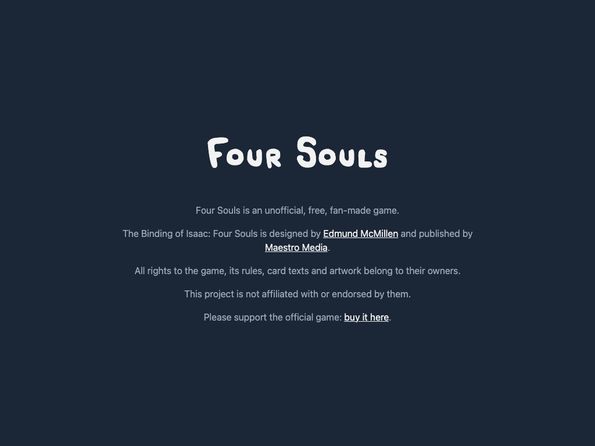
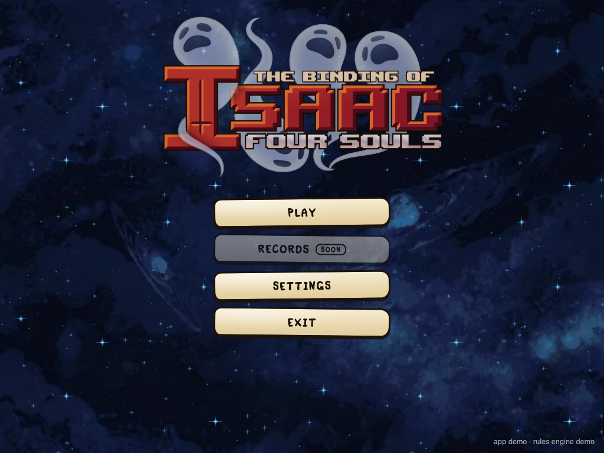
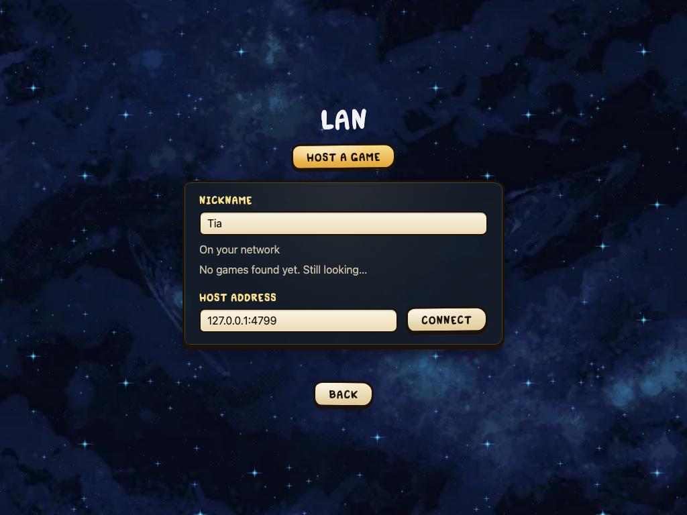

# First start

The release builds are not code-signed (B-03, B-04, B-05): signing costs money every year, and the game is free. So macOS and Windows warn the first time the app starts. `README.txt` in every archive has the same steps in short.

The first screen is the fan-game notice; the main menu follows it.

## macOS

macOS 15 (Sequoia) and later:

1. Unzip the archive, move `FourSouls` to Applications.
2. Double-click it. macOS says it "cannot verify that FourSouls is free of malware". Press **Done**.
3. Open **System Settings → Privacy & Security**. At the bottom: "FourSouls was blocked to protect your Mac". Press **Open Anyway**.
4. Confirm with **Open Anyway** and your password. From now on it opens normally.

macOS 14 and earlier: right-click the app, **Open**, then **Open** in the dialog.

For the terminal: `xattr -dr com.apple.quarantine /Applications/FourSouls.app` removes the download mark.

## Windows

1. Extract the zip (right-click → **Extract All**). Running from inside the zip fails.
2. Double-click `FourSouls.exe`. SmartScreen says "Windows protected your PC". Press **More info**, then **Run anyway**.
3. The app needs Microsoft Edge WebView2. Windows 10 and 11 usually have it; otherwise the app offers to install it.

## Linux

The app uses WebKitGTK 4.1:

| Distribution | Install |
|---|---|
| Ubuntu 22.04+, Debian 12+ | `sudo apt install libwebkit2gtk-4.1-0` |
| Fedora | `sudo dnf install webkit2gtk4.1` |
| Arch | `sudo pacman -S webkit2gtk-4.1` |

Then `tar -xzf four-souls-*.tar.gz` and `./FourSouls`. If it does not start, `chmod +x FourSouls`.

## Firewall

The first time a player hosts, Windows and macOS ask whether the app may accept connections. Allow it, or friends cannot join. More in [Playing over the internet](Playing-over-the-internet).

## Local network

**Play → LAN** lists games hosted on your network, and keeps looking while it is open; a game that already started shows "In progress", and if your app closed during it, **Rejoin** takes your seat back. On macOS 15 and later, the first search asks whether Four Souls may find devices on your local network: allow it, or the list stays empty. If you said no, turn it on in **System Settings → Privacy & Security → Local Network**. Guest Wi-Fi and some routers block these searches; typing the host's address always works.

The LAN screen lists the games it finds, and takes a typed address:

