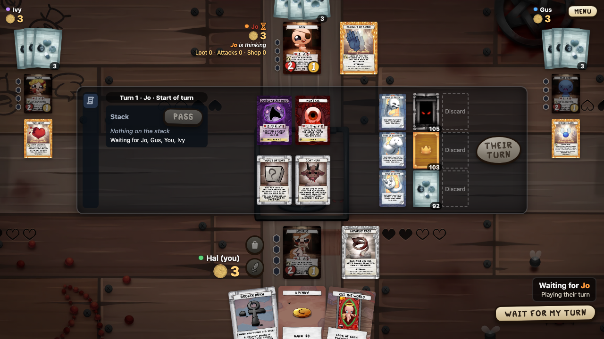

# Four Souls

Notes for the Four Souls fan game: a desktop network card game for 2–4 players, built with Wails (Go + React/TypeScript).

Pick your group: players, people who run a game server, translators, or developers. Developer pages describe the current code. Decisions live in `docs/architecture/` (ADRs); user-visible behavior in `docs/use-cases/`; the plan in `docs/roadmap.md`.

## Players

* [First start](First-start) — getting past the macOS and Windows warnings; Linux packages.
* [Playing over the internet](Playing-over-the-internet) — virtual LAN (Tailscale, ZeroTier, Radmin VPN, Hamachi) or port forwarding.

## Server admins

* [Dedicated server on a VPS](Dedicated-server-on-a-VPS) — rent a server and host games for friends.
* [Server as a systemd service](Server-as-a-systemd-service) — the server binary, started by systemd.
* [Server in Docker](Server-in-Docker) — one Dockerfile builds the latest release.
* [Server with Docker Compose and Caddy](Server-with-Docker-Compose-and-Caddy) — HTTPS on your domain.
* [Server from a local build](Server-from-a-local-build) — your own binary in the Docker setup.
* [Load test](Load-test) — play whole games against your server and see how much it takes.

## Translators

* [Translate the interface](Translate-the-interface) — one JSON file per language, its check, and screenshots in your language.
* [Translate cards](Translate-cards) — card names and texts in the card data, translator credits, card images.
* [Translating with an AI agent](Translating-with-an-AI-agent) — the todo/done loop and a ready prompt.

## Developers

* [Repo layout](Repo-layout) — where everything lives and why.
* [Developer setup](Developer-setup) — one script installs the tools; `make doctor` checks them.
* [Build modes](Build-modes) — embedded vs. external files, versions, platforms.
* [Profiling](Profiling) — runtime traces and profiles behind the `trace` build tag.
* [Linters](Linters) — strict Go and frontend linting, and how to run it.
* [Screenshots](Screenshots) — capture the UI without a real window.
* [Client](Client) — how the React client is put together: store, lobby, playback, table.
* [Animations](Animations) — every animation, who owns a card, and the clash checks.
* [Layers](Layers) — which window draws over which, and the order check.
* [Frontend tests](Frontend-tests) — unit tests, UI tests, and how to keep the frontend testable.
* [Internal builds](Internal-builds) — the app for play tests with friends.
* [Releases](Releases) — version tags, draft releases, archives.
* [Card data tools](Card-data-tools) — where card data and images come from.
* [Rules engine](Rules-engine) — map of the engine code and its main rules.
* [Effect blocks](Effect-blocks) — the blocks cards are built from.
* [Adding a card](Adding-a-card) — write and test a card, or a whole fan set.
* [Situation payload](Situation-payload) — sandbox situations and rules tests.
* [Fuzzing](Fuzzing) — random games that check the engine state.
* [Server](Server) — how the lobby, game rooms and transport fit together.
* [Banned cards](Banned-cards) — cards no game deals, and how to lift a ban.
