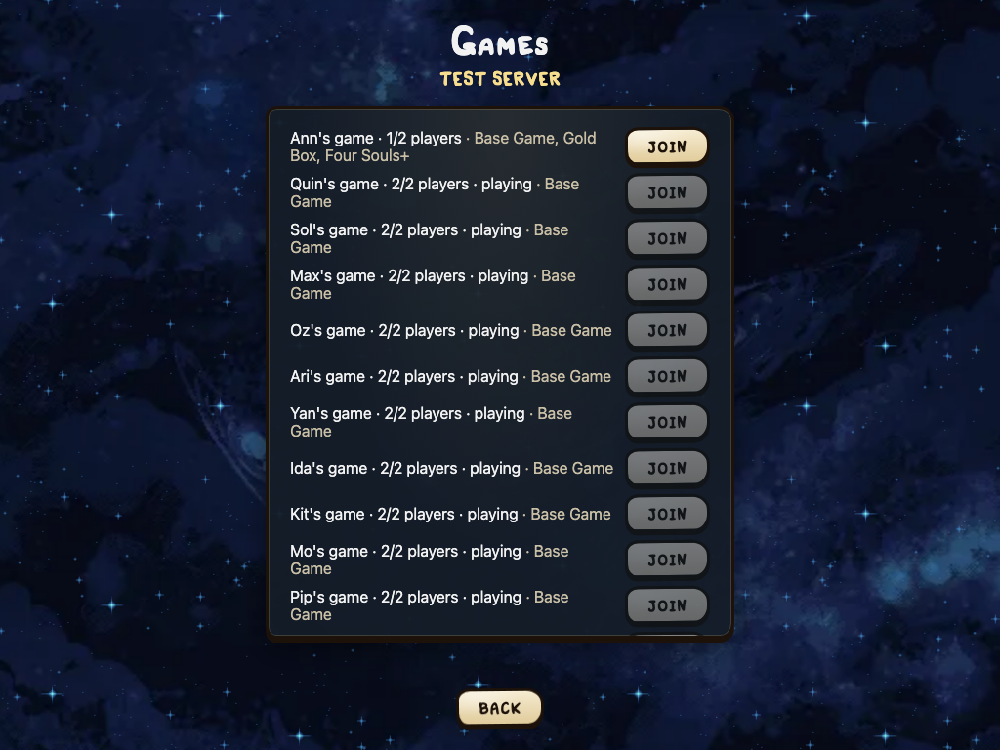

# Load test

`cmd/server_load` plays whole games against a running dedicated server and reports how much load it takes. It is a WebSocket client like the app: it sends intents and reads updates (ADR 006). It never changes the server.

## Run it

```sh
go run ./cmd/server_load -url ws://game.example.com:4774
```

Run it against a server you run yourself. The games it opens are real games on that server; they end on their own, or with the server's idle and length limits.

While it runs, the games appear on the server's Games list, as they would for any player:



## Stages

Each game seats 4 bots (`-players`) at one table and plays it to the end with random legal moves.

The games run in stages:

* stage 1: 2 games at once (`-start`);
* stage 2: 4 games at once;
* stage 3: 8 games at once, and so on, up to `-max-games` (default 64).

A stage passes when:

* every game ends, and no game fails or times out (`-game-timeout`, default 30 minutes);
* the slowest response is not over `-max-response` (default 1s).

The first stage that fails ends the run. The summary names the highest load that passed.

With `-stop-at 30`, the stage stops its other games once 30% of its games have ended (rounded up, at least one). Those games are counted as stopped, not failed. A stage that stops early measures how the server handles the load before most games end, not whole games.

## Flags

| Flag | Default | What it does |
|------|---------|--------------|
| `-url` | required | `ws://host:port`; the path `/ws` is added |
| `-players` | 4 | players per game, 2 to 4 |
| `-start` | 2 | games at once in the first stage |
| `-max-games` | 64 | most games at once |
| `-sets` | b2 | card sets, comma-separated |
| `-game-timeout` | 30m | a game that has not ended by then fails |
| `-max-response` | 1s | a stage fails when a response takes longer |
| `-seed` | clock | seed for the bots' moves |
| `-stop-at` | 0 | percent of a stage's games that, once ended, stop the others; 0 waits for all |
| `-bots` | none | `standard` or `hard`: the host seats the server's own bots in every other seat, and the tool plays the host's seat alone; the report adds the bots' turns |
| `-ban` | blue_baby | characters the host bans, comma-separated; Blue Baby starts with Forever Alone, whose loop is 19.97; `-ban ""` bans none |

## What it measures

* **response**: from an intent sent to the next update that seat gets. Min, median, p95 and max.
* **ping**: a WebSocket ping and its pong, once a second per bot.
* **handshake**: connect, hello and welcome.
* **updates**: how many updates the bots received, their size and the rate per second.
* **reconnects**: a bot whose connection drops takes its seat back with its token, as the app does. It waits 0, 1, 2, 4 and 8 seconds, then 10 between tries. The report counts the seats taken back and the tries that failed. A reconnect does not fail a stage; a seat that cannot come back fails its game.
* **errors**: error replies from the server by code; `refused` is an intent the engine did not accept.
* **notices**: a notice that ends a game (lost or idle) fails it.
* **agreement**: every seat must see the same last step and winners, or the game fails.

Progress is printed every 2 seconds. With up to 8 games it shows one part per game: its turn and step, then `done` or `FAILED`. With more, it shows counts of running, done and failed games.

## Bots

With `-bots standard` or `-bots hard`, the tool plays only the host's seat; the server's own bots play the others. The server must allow that level (`-bots` on the server, see [Server](Server)). The report gains a **bot turns** line: how long a bot's whole turn took, with the server's pauses between its actions.

To see a small public server, give the server one core and a memory limit:

```sh
GOMAXPROCS=1 GOMEMLIMIT=512MiB go run ./cmd/server -port 4774
go run ./cmd/server_load -url ws://127.0.0.1:4774 -bots hard -start 3 -max-games 3 -game-timeout 40m
```

With one core, only one hard bot thinks at a time. A hard bot that gets no turn to think within its budget (`-bot_think`, 1.5 s) plays that move as a standard bot, so it still answers in about 3 s.

Measured on 2026-11-17, 3 tables of 1 client and 3 bots, `GOMAXPROCS=1 GOMEMLIMIT=512MiB`. The machine was shared with other jobs, so the times are upper bounds:

| | Hard | Standard |
|---|---|---|
| Load average (start → end) | 12.0 → 5.4 | 9.2 → 1.5 |
| Games | 3 of 3 in 18 min | 3 of 3 in 21 min |
| Response median / p99 / max | 8.9 / 32 / 40 ms | 0.85 / 20 / 38 ms |
| Longest bot move | 3.1 s | 192 ms |
| Bot turn median / max | 49 s / 2 min 49 s | 21 s / 50 s |
| Peak memory (RSS) | 35 MB | 34 MB |
| GC share of the CPU | 5% | under 1% |
| Server's share of the core | 98% | 4% |
| Hard moves played as standard (no slot) | 54% | – |

Hard bots think for their whole budget on every move, so three hard tables keep one core busy for the whole game. On a 1-CPU host that also serves a website, prefer `-bots standard`, or a shorter `-bot_think`.

## Things to know

* A bot ends its turn after 500 steps of it, as a player would. A game that still does not end fails, and the error names its turn and step.
* A failed game stays on the server until the server's limits end it.
* A dropped bot leaves its game paused until it is back. Many reconnects under load mean the server cut connections that fell behind, which is a figure to watch next to the response times.
* The bots play random legal moves, so one game can take far longer than a real game of the same length.
* To see where the server spends its time under this load, record a profile: [Profiling](Profiling).
