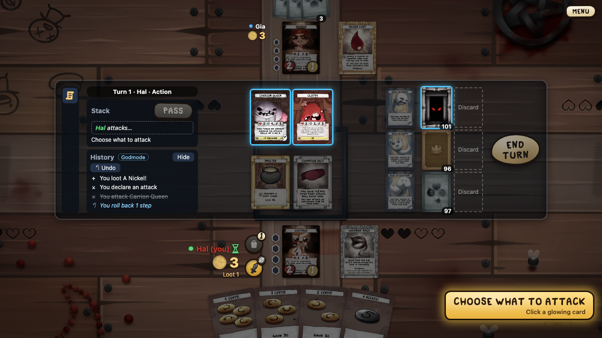
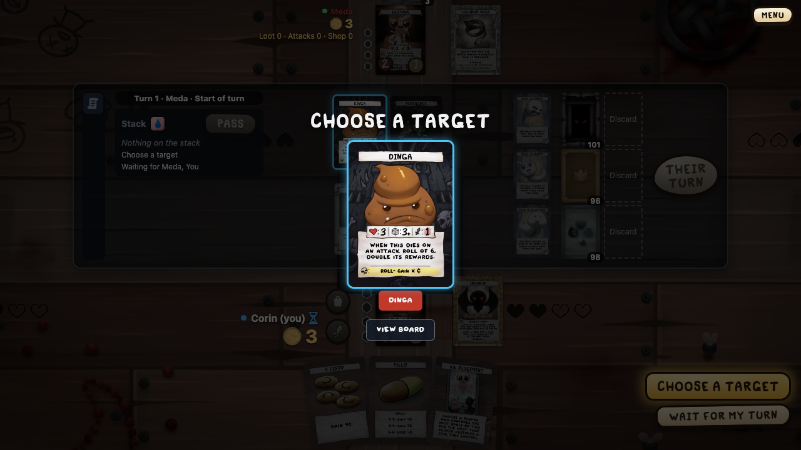

# Rules engine

Notes on `pkg/rules_engine` as it is now. The design and its reasons are in ADR 005 (`docs/architecture/005-rules-engine-design.md`); this page is a map of the code.

## The shape

The engine is a pure state machine. It has no files, network, clock or `math/rand` (enforced by `depguard`), so the same code runs on the server and in the browser (WASM).

```go
g, events, err := rulesengine.NewGame(setup) // deals, shuffles, asks the first throw
p := g.Prompt()                              // who must answer what
allowed := g.Allowed(p.Player)               // every intent that would be accepted
events, err = g.Apply(intent)                // validate, then run until input is needed
```

`NewGame` stops at the first-player roll (R-SETUP-11, 15.43): turn 0, `Game.FirstRoll` set, a throw prompt for seat 0 with the text `event.first_player_roll` (a message, see below). Each player throws in seat order (`Throw.First`); the lowest goes first, and the tied lowest throw again in a new round (`first_roll_tied`, its text the tied seats, "0,2"). Then `first_player` names the winner and the roll, `game_started` follows, and turn 1 begins. Start-of-game abilities come first (Eden's choice), then the roll (19.94); the roll's state and view start only once every such choice is made (`ActChooseFirstPlayer`, 19.142). Several start-of-game choices are open at the same time (20.22): `Game.StartChoices` holds one per player still choosing, in seat order, each with the next cards from the treasure deck's top, so no two players see one card. `Waiting` shows the first, and `Waiting.Players` names everyone who may answer now (`Prompt.Who`). `PromptFor(p)` is the prompt p answers: their own choice; `Allowed`, `check` and the view use it, so each chooser sees and answers their own, in any order. The order of the answers is in the record, so a replay is the same. The server's timer and kicked seats answer for each of them. A character with `GoesFirst` (Cain) skips the roll: `first_player` with text `character` and the card. The view has the roll as `first_roll`: round, players, this round's dice. Tests throw it with `enginetest.ThrowFirstRoll`.

`Setup.Banned` lists cards the host left out (GS-13): no copy goes into a deck, a banned character is never dealt, and the list stays in `Game.Banned`. A starting item cannot be banned; ban its character instead.

`Apply` either refuses the intent with a `RuleError` (rule ID plus reason, state unchanged) or applies it and runs automatic work until the game waits on a player again. The engine never picks for a player, even when only one option exists.

## State

`Game` (`state.go`) is plain data that encodes to JSON:

* players, objects, decks and discards, shop / monster / room slots;
* the action queue, the stack, pending triggers, the open priority window;
* turn, attack and purchase state, the current `Waiting` prompt or `Choice`;
* the RNG (PCG32) itself, so a saved game continues with the same rolls.

There are no maps in the saved state (map order is random). The card index is not saved; `Load` rebuilds it from the card sets.

Every card is an object with an ID. Moving a card to another zone gives it a new ID, as the rules treat it as a new object. So `g.Objects` only grows. Code that looks at "what is in play" must use `g.inPlay()` (characters, play areas, slot tops), not scan all objects.

## Where things happen

| File | What |
|------|------|
| `turn.go` | turn steps, priority windows, the `run()` loop, win check |
| `stack.go` | stack items, resolving, dice rolls |
| `actions.go` | the action queue and replacement effects |
| `combat.go` | attacks, damage, death, rewards |
| `shop.go` | purchasing |
| `ability.go`, `activate.go` | effect blocks, activating abilities, targets |
| `triggers.go`, `statics.go` | triggered and static abilities |
| `choice.go` | `Choose` prompts (targets, order of replacements and triggers, penalties) |
| `allowed.go`, `aims.go`, `blocked.go`, `view.go` | allowed intents, their first targets, and why the rest are not; per-viewer hidden information |
| `record.go`, `situation.go` | step records, replay, save/load; situation payloads |
| `invariants.go` | state checks used by tests and fuzzing |

Cards are Go values built from effect blocks; see [Effect blocks](Effect-blocks).

## Card sets

Each set is a package under `cards/`, e.g. `cards/b2`, with one file per card. `cards.Sets()` lists every set and `cards.Find("b2")` returns one.

`go run ./cmd/cardgen -set b2` (from the repo root) writes the files from `card_db` data:

* each card file holds the printed text as a comment, the game data (kind, copies, stats, soul, rewards, keywords) and a `TODO(card):` line;
* a file with that line is a stub and is rewritten on every run;
* when you implement a card, delete the line: the file is yours and the generator never touches it again;
* `set_gen.go` lists every card of the set and is always rewritten, so keep the variable name the generator chose;
* data it cannot read (e.g. a printed `X` or a rolled reward) is listed as `Not generated:` in the comment.

The generator lives in the app module because the engine never imports `card_db`.

## Card status report

`go run ./cmd/cardgen -report` rewrites `pkg/rules_engine/docs/card-status.md`: progress per set, per engine kind, per printed type and per card.

* Not started: the card file still has the `TODO(card):` line.
* Implemented: the line is gone.
* Tested: the card also has `<card>_test.go` next to it.

A test fails when the committed report is out of date, so run the command after finishing a card.

## Challenges

A co-op challenge (ADR 028; rules in `docs/rules/challenges.md`) is a regular game with `Setup.Challenge` (an `*engine.ChallengeDef`) and `Setup.Difficulty` (`normal`, `hard`, `ultra`). `cards.Challenges()` lists the known ones and `cards.FindChallenge(id)` finds one; each lives in `cards/challenge` beside its cards. The challenge's card set is no playable set (`cards.Sets()` leaves it out), so the caller adds it to `Setup.Sets`. `NewGame` refuses a challenge without exactly 2 players (R-COOP-01), with bonus souls (R-COOP-02), without its set, or with a difficulty it lacks.

`ChallengeDef` holds the ID, the set's code, and per difficulty (`Levels`) the final boss and the rule card. After the regular setup, `NewGame` makes `Game.Challenge` (`challenge.go`): the timer at 8, the rule card as an object outside the game, then the def's own `Setup(g, difficulty)`. `inPlay` lists the rule card last, so its abilities work like any card's. Every `ChallengeState` field is `omitempty`, so a regular game saves exactly as before (`testdata/regular_save.json`, ADR 019).

* Timer: `startNextTurn` ticks it (`challenge_timer`, the rounds left) before the starting player's next regular turn, skipped or not; an extra turn adds no tick (R-COOP-08, Q-34). At 0 the game is lost at once.
* End: `WinChallenge()` (`challenge_won`, both players in `Winners`) or `LoseChallenge(reason)` (`challenge_lost`, the reason as its label and in `Challenge.Reason`, no winners). `checkWin` and `WinGame` do nothing in a challenge (R-CHAL-14).
* Rooms: after the room step, a room whose top object is older than the active player's previous turn goes to discard (R-COOP-11, Q-39). Object IDs only grow, so `TurnFrom` and `RoundFrom` keep the first object ID of each player's last two turns.
* View: `GameView.Challenge` (ID, difficulty, timer, rule card, presents, lost and reason) for everyone; each player also sees the partner's hand (R-COOP-07, Q-42). Hand events stay private as in any game.

### Final boss and minion slots

A challenge has two more slot rows beside the monster slots (`boss_slots.go`, R-CHAL-02 to R-CHAL-12): `Game.Bosses` (`FinalBossSlot`) and `Game.Minions` (`MinionSlot`). Both are `omitempty`, so a regular game saves as before; the view has `GameView.Bosses` and `GameView.Minions`.

* "Monsters in play" is `g.MonstersInPlay()`: the tops of the monster, final boss and minion slots, in that order (`MonsterRows()`). Attack targets, Mom's Eye Shadow, `TargetMonster` choices, "each monster" and every card's `monstersInPlay` (cardkit) use it.
* "Monster slot" effects stay on `g.Monsters`: covering, refilling, expanding, putting a card into a monster slot, deck attacks, Indomitable, Ace of Diamonds' count. So a final boss is never covered, and neither row is refilled.
* `Held(id)` is a final boss or minion: it can't leave unless it is killed (R-CHAL-04, R-CHAL-10, Q-37). `DiscardMonster`, `PutIntoDeck`, `SlotToDeckBottom` (and so `ToBottomRandom`) do nothing to it; `PutUnder` takes monster slots only.
* Boss armor (R-CHAL-05) is one rule in two places: `killObject` (both `Kill` and `KillObject`) gives a final boss 3 damage instead; `resolveDamage` caps one non-combat instance at 3 (`armored`). Combat damage is never capped.
* A dead final boss leaves its slot empty. A minion slot is removed when its card leaves (`takeFromSlot`); later minions' `Zone.Index` shift down (`dropMinionSlot`). `CheckInvariants` checks that every slot card's zone names its row and slot.
* `PutInFinalBossSlot(card)` is for a challenge's setup. `PutInMinionSlot(id)` (a monster deck card) and `MinionFromDeck()` give the card a new minion slot; an event there resolves, goes to discard, and its slot goes (R-CHAL-12).
* A minion dies like any monster; challenge-specific rewards are the challenge's job (R-KRAMPUS-14).
* `PutInMinionSlot` and `MinionFromDeck` emit `minion_arrived` (after the slot's `card_revealed`).

### How the Krampus Stole Christmas

The first challenge (14.22; rules R-KRAMPUS-01 to 15, open cases Q-30 to Q-41) lives in `cards/challenge`: `krampus.go` holds `Krampus` (the `ChallengeDef`), its setup and the shared parts; each card file builds its card from them. Nothing in the engine names Krampus: the cards use generic `CardDef` hooks and the presents API (ADR 028, Decision 6.4).

* Setup (`krampusSetup`): `PutInFinalBossSlot` with the difficulty's Pilfering Krampus, then `AddPresent` four times: the top treasure card goes outside the game, face down, with its counters (8/2/3/3, 12/4/3/3, 16/4/3/3).
* Presents (`challenge.go`): `ChallengeState.Presents` keeps kind, card, `Destroyed` and `Flipped`. Only the challenge's cards call `AddPresentCounters` (never below 0, nothing on a gone present; emits `present_counters`), `DestroyPresent` (to the treasure discard; `present_destroyed`; reports whether all 4 are gone), `FlipPresents` (once: `Holidays`, counters off, `presents_flipped`), `GivePresent` (a charged item, like any gained item; `present_given`) and `Forgo` (`forgone`, then the counters). `SoulsInPlay` is both players' soul value, characters too (Q-30).
* The boss cards print the boss rules, so they hold them:
  * `Guarded` (new hook): while it returns true the monster can't be attacked and takes no damage. `CanBeAttacked` checks it with `Unattackable` for attack targets, Mom's Eye Shadow's redirect and Monster Manual's forced attack; `resolveDamage` prevents the damage (`prevented`). Boss armor turns an outright kill into 3 damage first, so a guarded boss takes none (R-KRAMPUS-11).
  * The start-of-turn roll is a triggered ability with `RollTimes`: 1 roll, plus `minions / 2` on Hard or `minions` on Ultra Hard, counted once as it resolves (R-KRAMPUS-12, Q-41). Each roll resolves with its table result before the next.
  * `MustAttackRandom` (new hook, Normal only): while it lists attackable monsters and the duty is unmet (`Turn.RandomAttackMade`), the active player who can attack can't end the turn, and a declared attack goes to one of them picked at random (`random_pick`), with no deck option. With another forced attack (Monster Manual, the regular Krampus, Blind Rage's deck attack) the target choice offers it plus `ask.attack_random` (`Choice.Random`); a deck attack picked away stays owed (R-KRAMPUS-13, Q-31).
  * `NoSpoils` (new hook): asked as a monster dies, still in its slot; the dead card is marked `NoSpoils`, gets no rewards step and goes to discard instead of becoming a soul (R-KRAMPUS-14).
* The rule card holds the global modifiers and the goal; its triggered abilities are the active player's (`abilityController`):
  * All I Want for Christmas is an optional replacement: `Replacement.May` (new) asks the affected player yes or no (`ChooseMayReplace`) before it applies; a no counts as applied. It replaces a monster's reward part (`Action.Reward`, set by the rewards step and by roll rewards after the roll) or a dead card's soul (`ActBecomeSoul`; the card then goes to discard), only while that kind's present is face down (R-KRAMPUS-07, Q-32, Q-33). Other gains, and an item or event that becomes a soul, are not offered. With other replacements (Lucky Toe) the player orders them as usual, and the forgo is asked when its turn comes.
  * What's in the Box? triggers on `present_counters` that leave a present at 0; as it resolves, a present still at 0 is destroyed, then 3 or 4 `MinionFromDeck`; the fourth destroyed present calls `LoseChallenge` with `event.challenge_lost.presents` instead (R-KRAMPUS-08, R-KRAMPUS-09).
  * Happy Holidays! triggers on `gained_soul` while `SoulsInPlay` reaches 5, 6 or 7 and it has not happened; it flips the presents first, then asks the active player who gains each, ¢, loot, treasure, soul; a gone present is skipped (R-KRAMPUS-10, Q-40).
  * The goal: when the difficulty's Pilfering Krampus dies, `WinChallenge` (R-KRAMPUS-01).
* View: `ChallengeView.Presents` shows kind and counters face down; `destroyed`, `flipped`, the card once face up, and the player who gained it.
* Tests: `cards/challenge/*_test.go`, one file per card plus `krampus_test.go` (setup, whole seeded games won and lost, replay and load). `FuzzChallengeSets` flags 1 to 3 and `TestSimulations` play Krampus too (wiki [Fuzzing](Fuzzing)).

### Trick or Treat blocks

The generic pieces Trick or Treat needs (14.31; rules R-TRICK-01 to 17, open cases Q-43 to Q-54). Each is one shared rule in the engine; the challenge's cards (14.32) only use them, and any other card may too. Tests with test cards: `cards/trick_blocks_test.go`.

* Counters on players (`player_counters.go`): `Player.Counters`, on the player, not the character, so they stay on a death and a character change (R-MECH-13, Q-45). `AddPlayerCounters(p, name, n)` (never below 0; returns the change; emits `player_counters`), `PlayerCounters(p, name)`, `PlayersWithCounters(name)` (the choices of "remove a fear counter from a player", Q-51). The view has `PlayerView.Counters`. Objects and players share the counter list code (`countOf`, `addCount`).
* Evasion from counters: the static `MonstersHavePerCounters(StatMonsterDC, "fear", 2)` gives every monster in play (all three rows) +1 per 2 counters on the active player. It is a normal static, so `Evasion` reads it when each attack roll resolves, clamps it at 6, and the V-41 parts name its card (Q-52).
* Attack start: `startAttack` emits `attack_start` after `attack_target` when the target is a monster, so for a deck attack only once the revealed monster is in its slot; an event, a player or an item gets none. `AtStartOfAttackOnMonster()` triggers on it. `nextTriggerGroup` places attack-start triggers first, so they lie below the target's own triggers and resolve after them; the first roll waits for the empty stack (R-ATK-25, Q-53).
* Reward changes (`rewards.go`): `AddReward(id, kind, n, source)` and `SetRewardsToCents(id, n, source)` go into `Game.RewardChanges` (till end of turn; `rewards_changed`). `Rewards(id)` applies them in the order made: "become ¢" replaces everything before it, later additions add (Q-48). A dying monster's changes move to its dead card, and the rewards step reads `Rewards`, so doubling (Dinga) and the Krampus forgo (`Action.Reward`) work on the changed rewards. The soul is no reward.
* More damage taken: `StatDamageTaken`. `IncreaseDamageTaken(p, n, source)` is a boost till end of turn; Daddy Haunt is `YouHave(StatDamageTaken, 1)`. `resolveDamage` adds it to each instance a player takes after shields, before the `DamageMod` cards that lower damage (Dry Baby, The Dead Cat). Several add up (Q-46).
* Gained monster abilities: `RevealUntilMonster(p)` reveals monster deck cards (`card_revealed`) until a non-event monster, refilling from the discard if needed, then puts every revealed card on the bottom in random order (Q-22, `deck_bottom`); "" if none. `GainRevealedMonster(id, p)` gains that card's abilities till end of turn (Q-47). `GainAbilities` now adds gains up: the first stays in `Object.Gained`, later ones in `MoreGained`, each with its own end. Gained faces also bring `CombatMod` and `Unattackable`; other `CardDef` hooks stay the card's own. A gained "when this dies" triggers, since the death looks at the old object.
* Flip of the rule card: `Flip` also turns the challenge's rule card, which is outside the game; then only its face up has abilities (`CardOf`, ADR 023). `FlipThis()` is the shared "flip this" effect (Anima Sola uses it); "you may" wraps it in `cardkit.May`. `AtStartOfEachTurn()` is the trigger. The view's `ChallengeView.Card` shows the face up with `flipped` (ADR 023, option 5).
* Triggers 14.32 needs: `WhenAPlayerTakesDamage()` (new; one `damaged` per instance, none when prevented, Q-50), `WhenAMonsterDies()` (`died`, Q-54), and `rewards_gained` once per dead card whose rewards the receiver gains; `len(Rewards(e.Object))` tells whether there were any (Q-54.5).

### Trick or Treat

The second challenge (14.32; rules R-TRICK-01 to 17, open cases Q-43 to Q-54) lives in `cards/challenge`: `trick_or_treat.go` holds `TrickOrTreat` (the `ChallengeDef`, ID `trick_or_treat`), its setup and the shared abilities; the card files build on them. It uses the blocks above and nothing else new but one event.

* Setup (`trickSetup`): `PutInFinalBossSlot` with the difficulty's Mischievous The Haunt, then 12, 14 or 14 `trick` counters on it (`AddNamedCounters`). All three levels share the rule card `trick_treat_normhardultra`, Trick side up. The regular The Haunt stays in the monster deck (Q-49).
* The boss cards (`haunt`) hold:
  * `Guarded` while its trick counters exceed `SoulsInPlay` (R-TRICK-06, Q-30); equal is no guard. Boss armor turns an outright kill into 3 damage first, so a guarded boss takes none.
  * Fear: `WhenAPlayerTakesDamage` puts a `fear` counter on the damaged player, on each player at Ultra Hard; one per instance (R-TRICK-07, Q-50).
  * `MonstersHavePerCounters(StatMonsterDC, "fear", 2)` (R-TRICK-09, Q-52).
  * The death roll: on each monster death the active player rolls; 4–6 asks them which player with a fear counter loses one (`card.trick_treat.remove_fear`; no fear anywhere, no question; R-TRICK-10, Q-51).
* The rule card: both faces hold the optional flip (`AtStartOfEachTurn`, `cardkit.May`, `FlipThis`; the question names the side it would show) and the goal (any Mischievous The Haunt dies: `WinChallenge`), so a flip never drops them. Its triggers are the active player's (Q-44).
  * Trick: Nobody's Fool (`WhenAMonsterDies`: a trick counter off each final boss; Q-54) and Ghostly Trickery (`AtStartOfAttackOnMonster`, `RollTimes` 1, 2 or 3 by `Challenge.Difficulty`): 1–2 `IncreaseDamageTaken` on the active player, 3–4 `GainRevealedMonster` on the attacked monster, 5–6 `SetRewardsToCents(1)` (Q-46 to Q-48, Q-53).
  * Treat: You Don't Scare Me (`rewards_gained` of the active player whose dead card has `Rewards`; the same fear question; Q-54) and Hallows' Eve Bounty (one roll at every difficulty: `AddReward` 3¢, loot 1 or 1 treasure).
* Events: `GainRevealedMonster` now emits `abilities_gained` (Text: the gained card). History lines: fear gained and lost, trick counters off, damage taken up, rewards changed, abilities gained; a flip has its line already.
* There is no loss of its own: only the timer (R-TRICK-01).
* Tests: `cards/challenge/*_test.go`, one file per card plus `trick_or_treat_test.go` (setup, whole games), one test per rule and open case, with real cards (Boom Fly gained, Dinga and Blessing of the Sack on 1¢, Daddy Haunt, Chaos Card and Bomb! on the guarded boss), and seeded whole games won and lost. `FuzzChallengeSets` flag bit 3 and `TestSimulations` play it at every difficulty.

## The run loop must always settle

`run()` keeps doing automatic work (queued actions, triggers, step changes) until the game waits on a prompt. Any path that leaves no prompt and changes nothing spins forever. Rules for new code:

* every step either opens a priority window, asks something, or moves to the next step;
* a window step with no open window opens one again instead of returning;
* priority given while actions are queued is deferred (`Priority.Deferred`) and opened once the queue is empty;
* `maxRunSteps` turns an endless loop into a panic with a clear message, so tests and fuzzing fail instead of hanging.

## Max HP going down

HP left is max HP minus marked damage, and max HP comes from bonuses that can go away at any time (an item leaves play, a counter goes, a room changes). R-MECH-21 says a lower max HP also removes that much damage, so the HP left only drops when there was less damage than the loss. `checkMaxHP()` (`combat.go`) applies this for players and for in-play objects with HP: it runs at the start of `Apply`, after the intent, and on every `run()` step, and compares each max HP with the one from its last run. A player or monster that ends at 0 HP this way gets its death on the stack (R-DEATH-01). The last max HP (`g.maxHP`) is not saved and not in the checksum: between `Apply` calls it always equals the current max HP (19.46).

## Free loot plays

Distant Admiration plays a given loot card "if able" without a loot play. `ActPlayLootFree` first runs the play checks except the loot play count (`lootPlayable()`, shared with the `IntentPlayLoot` check); a card that fails them, such as Butter Bean! with nothing on the stack, stays in hand. A playable card is marked in `Game.FreeLoot`, and the play spends no loot play for it (`spendLootPlay()`). A cancelled mode, target, or copy prompt clears the mark, so the card stays in hand at no cost (19.60).

## Replay and rollback

With rollback on, the History panel has an Undo button, and undone steps stay greyed:



`Step` returns a `StepRecord`: the intent, its events, and its checksum. The checksum extends a hash chain (`Game.Chain`, ADR 025): each step hashes the chain so far with its intent, its events and the RNG. Every 100th applied step (`Game.Applied`, `anchorEvery`) also mixes in a hash of the whole state, so a state that differs without showing in the history is caught there. `Game.Checksum()` is that whole-state hash. `Replay(setup, steps)` rebuilds a game from its setup; `ReplayFrom(state, steps, sets...)` rebuilds it from a saved base state (`Save`) instead. Both stop at the first step that is refused or whose checksum differs (`ErrMismatch`).

A rollback to before step k is `ReplayFrom(base, steps[:k], sets...)` (ADR 020, item 7). The base keeps the RNG, so the rebuilt game rolls and shuffles exactly as it did: a roll that is rolled back comes out the same again. Nothing reseeds. `undo_test.go` covers undoing a loot play, an attack and a purchase; the fuzz targets undo and redo at a random step.

`Barrier(Event)` (`barrier.go`) says whether an event stops a Soft rollback (ADR 020, item 4): dice, damage and death, hidden information seen, a turn's end, the game's start and end, and any private event but two: a card a player puts from their hand on the loot deck (private `moved_to_deck`, `privateNoBarrier`) shows no deck card, so a played card before it stays undoable (17.6); a kept or bottomed top card (`top_choice`, 19.90) follows its `looked_at`, which already is a barrier. Every event kind is sorted in `barrierKinds`; `TestBarrierKinds` pins the list and fails on a new kind until it is sorted.

`Load` needs the same engine; a base saved by another engine goes through `Resume` first (ADR 019).

## Testing

* Rules tests name the rule they check (`R-…` IDs from the rules document).
* [Situation payload](Situation-payload): build a position from JSON, run intents, compare the result.
* [Fuzzing](Fuzzing): random games with invariant, leak and replay checks.
* Determinism: replaying the same setup and intents must give the same checksum after every step.

## Choice options in views

A choice shows its options as big cards over the dimmed board:



`GameView.Options` tells the chooser what each option of a choose prompt points at (`OptionView`: an object, a player, a deck, or a stack item), one per `Waiting.Options`. Clients use it to let the player pick on the table. It is built from `g.Choice` at view time, so it is not saved state and does not change checksums.

`GameView.Activating` names the card whose mode or targets the open choice asks for, while a play or use is being put on the stack (`g.Activating`). Only the chooser gets it, like `Options`, so a hand card is never named to others. Clients aim from that card (15.34).

## Why an intent is not allowed

`Game.BlockedTurn(p)` (`blocked.go`, 15.29) lists what player p can't do now for the turn actions, each with a short reason for the player; `Game.BlockedCard(p, id)` gives the reasons for one card, asked for on a click; `Game.Blocked(p)` is both: every loot card in their hand, every card of theirs with an activated ability, every room with one, and attack, purchase and end turn. Allowed intents are left out. Each intent is run through `check` as if p held priority, with `Waiting` put back after: a refusal then gives the real reason, from `RuleError.Say`; no refusal means p only waits (`refuse.wait_priority`, or `refuse.answer_prompt` while p has another prompt open). The turn actions first say why the turn itself stops them (`refuse.not_your_turn`, `refuse.wait_stack`). `Say` is a message set with `deny` at the refusals a player meets; a cost that can't be paid says which (`costSay`). A refusal without words reads `refuse.not_usable` (`RuleError.Msg`). `Reason` stays English, for logs and developers. Reasons never name a card, so they leak nothing. The server sends them as `update.blocked`; the engine itself never reads them.

## Counts in views

`PlayerView.LootPlays`, `Attacks` and `Purchases` are what a player may still do now, bonuses included (attacks and purchases only for the active player). `CardView.Counters` copies the object's counters. `CardView.Stats` is set on monsters only: live `HP`, `DC` and `ATK` from `HP`, `Evasion` and `MonsterATK`, and the printed ones from the card definition (the printed DC clamped like `Evasion`). Like `Options`, they are computed at view time.

Stat sources (V-41, 15.54): every stat bonus goes through `bonus()` in `statics.go`, which sums `eachPart()`: each boost of this turn and each static ability in play that applies now. `Parts()` lists the same rows, so the shown sum can never drift from the one the rules use. A `Part` names its `Source` object, its `Amount`, how long it lasts (`LastsInPlay` for statics, `LastsTurn` for boosts, `LastsNextRoll` for "next attack roll" boosts) and an optional `When` from the static (`"first attack roll"`). A conditional static is listed only while it applies. The shown ATK reads `atkGame()` (19.67): the game itself while the active player's combat damage is on the stack, else a shallow copy with the next attack roll made. So Champion Belt's +1 ATK shows ahead of the first attack roll and while its damage is on the stack, and goes once that damage is dealt or the roll missed; the rules still count it only for that damage. `Boost.Source` is the ability's source object (`Ctx.Source`); boosts that never show as stats (used marks, the death-penalty item) leave it 0. The view sends the rows as `sources`: on `PlayerView` (HP, ATK, rolls, attack rolls, next attack roll, the DC of attacked monsters) next to `printed_hp` and `printed_atk`, and on a monster's `stats` (HP, DC, ATK, plus the attacker's "monsters you attack" change while it is the target, as `Evasion` counts it). A source in a hand or deck shows neither its card nor its id (`publicCard`).

Attack odds (15.94): `rollResult()` (`stack.go`) is a die with its changes as the roll resolves: 1 to 6, then Eternal D6's 2 or 3 to 1. The resolution and the view share it. `rollParts()` lists what a roll counts: roll changes, and for an attack roll the attack-roll changes and the next attack roll's boosts, as `useNextAttackRoll` uses them. `AttackView.Odds` is set once the attack is aimed at a card in play: the target's `Evasion`, the faces 1–6 whose `rollResult` reaches it (`Hits`), and the ATK of a hit, from a shallow copy of the game with `AttackRolls` one higher, so "first attack roll" statics count before the roll is made. Combat changes of the target or attacker (`CombatMod`) and helpers' rolls are not in the odds. A thrown roll's stack item gets `Sources` and, when they change it, `Final` in the view; `EvRollResolved` carries the same `Sources`, taken before the next-roll boosts are used.

## Who the stack waits for

In an open priority window, `GameView.Passed` lists the players who passed in a row (first passer first) and `GameView.Responding` lists those who may still respond, the waiting player first (V-11). Priority goes round once in turn order, so both come from `Priority.Holder` and `Priority.Passes`. Outside a window (a choice, a discard) both are empty. The server's automatic passes (N-05, N-16) go through the engine, so skipped players show up in `Passed`.

`Game.Threatens(item, player)` (`threat.go`) says whether a stack item may hurt a player: it targets them or their cards (unless the target was spent as a cost), it is damage to them or their cards, or its ability's `Takes` names them because it picks its victim only as it resolves. An item of the player's own, or of nobody (a death), never does. The server uses it to end "Wait for my turn" (15.84 – 15.86).

`GameView.Attack` is the active player's attack while it lasts: its target once chosen, and `Deck` for an attack declared on the monster deck. `GameView.Buying` is a declared purchase. Both come from `Game.Attack` and `Game.Purchase`, are public, and let every seat say what the active player does (15.30).

`GameView.WinSouls` is the soul value that wins (`Game.WinSouls`, R-WIN-01), so clients can show how close each player is (V-30).

## Private events

An event with `Private` shows its card only to `Player` and to the players in `SeenBy`; `FilterEvents` blanks `Card` and `Object` for everyone else (judges see all). `GiveHandCard` sets `SeenBy` to the giver, so a steal shows the card to the thief and the victim only (V-14). `Text` keeps the giver for all viewers. A death event's `By` is the killer plus 1, for the history (15.88). `Prev` is the object an event moved away under a new ID: the dead card of `died`, the stack card of a `discarded`, and the covered card of an uncovered slot's `card_revealed` (`uncover`, 19.72); a refill, a deck attack or setup leaves it 0. A dead card's held object is the `Prev` of its `discarded` (`ActDiscardObject`, with no player) or its `gained_soul` (`GainSoul`), so the client flies it from where it died (19.73). `TestEventKindsListed` keeps `testdata/event_kinds.txt`, every `EventKind`, for the client's history table.

## Messages

Every word a player reads from the engine is a message (ADR 021, 16.4): `Msg{Key, Args}` in `msg.go`, sent as `{"key": "refuse.attack_cost", "args": {"n": 2}}`. The words are only in `frontend/src/locales/en.json`; each client shows the line in its own language, so records and saves hold no language. Values are numbers, plain strings, cards (`CardArg`, `{"card": ref}`) and players (`PlayerArg`, `{"player": seat}`); `Args` keeps their order and encodes as one object, so the state has no Go map.

Keys are declared once, at package level, with `NewKey("area.name")`; `Keys()` lists them. Areas: `refuse` (reasons: `Block`, `Aim`, `RuleError.Say`, deck ratios), `prompt` (the engine's own questions), `event` (stack labels: `StackItem.Label`, on `stack_added`, `stack_resolved`, `cancelled` and `dice_rolled` as `Event.Label`), `ask` (options and questions many cards share), `card.<card id>.<name>` (a card's own lines) and `error` (server and app errors). The engine's keys are in `keys.go`; shared options (`AskYes`, `CardOption`, `DeckOption`, …) in `msg.go`; shared card questions in `cards/cardkit`. `Key` is a struct, so a bare string never compiles as a key, and `CheckInvariants` fails on a prompt or stack label whose key was not declared.

What stays a plain string: `Event.Text`, a code for the client and for card triggers ("combat", "attack", "starting item"), never shown as it is; an ability's and a mode's words, which are card data (`StackItem.Text`, `ModeView.Text`, the `{text}` of `ask.words`, `ask.ability` and `event.words`) until card texts are translated (16.5 and later); `RuleError.Reason` and other Go errors, for logs.

Tests and situation payloads answer prompts by an option's plain form (`Game.Plain`): a card's ref, `"player 2 (cain)"`, a number, a card's own words, `"card: words"` for an ability, else the key and its values (`"ask.yes"`, `"ask.slot_card 1 fly"`). `Msg.String()` is the same without the game, for logs and test failures.

`TestServerKeys` (`keys_test.go` in the app module, which links the engine, every card set, the server and the app) writes the registry to `frontend/src/locales/server-keys.json`; `go test . -run TestServerKeys -update` rewrites it, and the test fails while it is stale. `TestServerKeysInEnglish` fails on a declared key with no line in `en.json`; the client's `i18n.test.ts` reads the file for its unused-key check.

Engine 0.4.0 made this change; records of older engines cannot replay (`CanReplay`), and `StateMeaning` 2 ends games kept over a restart from before it.
