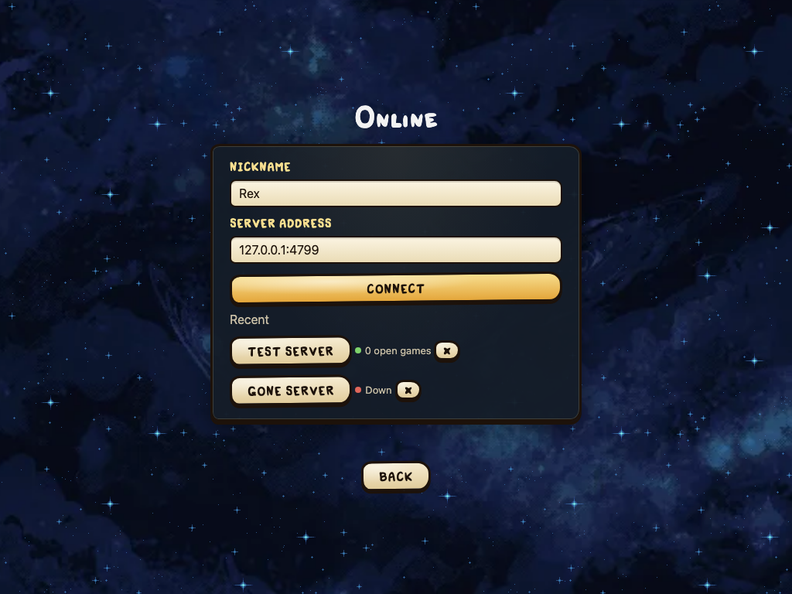

# Server in Docker

One file builds a small image (Alpine, about 35 MB) with the server of the latest release; no source code is needed. Read [Dedicated server on a VPS](Dedicated-server-on-a-VPS) first: the port, options and safety are there.

You need Docker with BuildKit (any Docker from version 23 on). Install it with your distribution's packages or [Docker's guide](https://docs.docker.com/engine/install/).

## 1. Build

Put the Dockerfile and `build.sh` from the repository (`deploy/docker/`) into an empty folder and build:

```sh
mkdir -p ~/four-souls && cd ~/four-souls
base=https://raw.githubusercontent.com/FourSoulsRepo/four_souls/main/deploy/docker
curl -fsSLO "$base/Dockerfile"
curl -fsSLO "$base/build.sh"
chmod +x build.sh
./build.sh
```

`build.sh` finds the newest release, e.g. 0.3.2, and builds one image with two tags: `four-souls-server:0.3.2` (the app version) and `four-souls-server:latest`. The version is also in the `org.opencontainers.image.version` label. The build downloads `four-souls-server-linux-<cpu>.tar.gz` of that release for the machine's CPU (`amd64` or `arm64`).

## 2. Run

```sh
docker run -d --name four-souls --restart unless-stopped \
  -p 4774:4774 -v four-souls-data:/data \
  -e FOUR_SOULS_NAME=Basement \
  four-souls-server:0.3.2
docker ps                         # STATUS shows (healthy) after a few seconds
docker logs -f four-souls         # its output
```

* Records and saved games live in the `four-souls-data` volume (`/data` inside the container); they survive updates.
* Settings are the `FOUR_SOULS_*` variables of the Options table, each with its own `-e`. Leave `FOUR_SOULS_RECORDS`, `FOUR_SOULS_SAVES` and `FOUR_SOULS_PORT` as they are; change the outside port with `-p 5000:4774` instead.
* The server runs as the user `four-souls`, not root.
* The healthcheck asks `/healthz` every 30 seconds; `docker ps` and `docker inspect` show the result. Docker does not restart an unhealthy container by itself; `--restart unless-stopped` restarts it when it exits.
* `docker stop four-souls` keeps every game in the volume; the next container goes on with them (N-20).

Players check it the same way: **Play → Online**, then the server's address.



## Updating

Run `./build.sh` again. It builds the newest release; the download happens again only when that release is new (otherwise the build finishes at once from its cache). Then replace the container with the new version tag; the volume keeps the data:

```sh
cd ~/four-souls
./build.sh
docker stop four-souls && docker rm four-souls
docker run -d --name four-souls --restart unless-stopped \
  -p 4774:4774 -v four-souls-data:/data \
  -e FOUR_SOULS_NAME=Basement \
  four-souls-server:0.3.2             # the tag build.sh printed
docker logs four-souls | grep '^app'   # app 0.3.2, rules engine ...
docker image prune -f                  # removes the old images
```

Replacing the container keeps the running games, as long as the new one gets the same volume; players see a short "Reconnecting…" and play on (see Updating on [Dedicated server on a VPS](Dedicated-server-on-a-VPS)).

To also pick up a newer Alpine base after a new Dockerfile, download the Dockerfile and `build.sh` again first (step 1); the Dockerfile pins the Alpine version.

## A fixed release

To stay on one release instead of the newest, give its version to `build.sh`:

```sh
./build.sh 0.3.1
```

Then run `four-souls-server:0.3.1`. This works for releases that have server archives (from the first release after 0.1.1 on).
