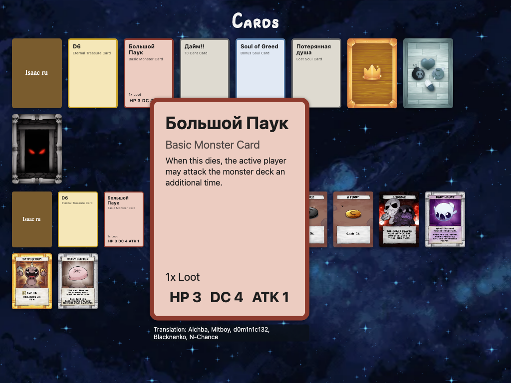

# Translate cards

This page is for translators of card names and card texts. The interface (menus, buttons, messages) is a separate file: [Translate the interface](Translate-the-interface).

Get the code and the tools first, as in [Translate the interface](Translate-the-interface#1-get-the-code-and-the-tools): fork, clone, `scripts/setup.sh --profile translator`. [Developer setup](Developer-setup) has the details.

## Where card text lives

Every card set is one JSON file in `pkg/card_db/data/`:

| File | Set |
|---|---|
| `b2.json` | Base Game V2 |
| `g2.json` | Gold Box V2 |
| `fsp2.json` | Four Souls+ V2 |
| `r.json` | Requiem |

Each card has a `text` object with one entry per language, by the same two-letter code as the interface file (`de`, `ru`). English (`en`) is always there; Russian has names for every card. The format is ADR 004 (`docs/architecture/004-card-data-format.md`).

```json
{
  "id": "the_d6",
  "type": "Eternal Treasure Card",
  "text": {
    "en": {
      "name": "The D6",
      "effects": [
        "{Tap Effect}Choose a dice roll. Its controller rerolls it.",
        "At the end of your turn, recharge this."
      ],
      "footnotes": [
        { "title": "-Eternal-", "text": "This can't be destroyed or put into discard." }
      ]
    },
    "ru": { "name": "D6" },
    "de": { "name": "Der W6" }
  },
  "translators": {
    "ru": ["Alchba", "Mitboy", "d0m1n1c132", "Blacknenko", "N-Chance"],
    "de": ["Your Name"]
  }
}
```

Find a card by searching its English name in the file. Add your language next to `en`; change nothing else.

## Fields

`text.<code>` takes the same fields as English:

| Field | What |
|---|---|
| `name` | the card's name; required for every language you add |
| `effects` | the printed effect lines, a list |
| `footnotes` | keyword boxes, each `title` and `text` (`-Eternal-`) |
| `notes` | extra notes, a list |

Only `name` shows in the game yet: card texts stay English on screen for now (step 16). Translated `effects` and `footnotes` are kept in the data for later.

Rules:

* Icons in text are written `{Icon Name}`: `{Tap Effect}`, `{Paid Effect}`, `{Curse Effect}`, `{HP}`, `{ATK}`, `{DC}`, `{LV4 Effect}`. Keep them exactly as in English, in English letters; they are drawn as icons.
* A two-sided card has a `back` with its own `text`: translate the back's name there (`back.text.ru.name`), apart from the front's (ADR 023).
* A later version of a card (`"version": 2`) is its own entry; translate it too.
* An entry with `"reprint": true` only adds copies to a card of an older set and has no text; translate the card in its own set instead.
* Cents are written `3¢`.

## Credit the translators

`translators.<code>` lists the people who translated this card into that language, names only (idea CD-06). The game shows them under the zoomed card when that language is chosen. Add it to every card you translate; use the name you want to be credited with.

## Re-scrapes keep translations

The card data is rebuilt from the official sources now and then (`scraper build` in the separate tools repository, [Card data tools](Card-data-tools)). That rebuild rewrites English and keeps every other language's `text` and `translators` as they are, by card ID and version (16.5). Your work is not lost; but when the English text of a card changes, nobody flags your translation, so look at the change when you update.

## Check

```sh
go test ./internal/assets/ ./pkg/card_db/...
```

It loads every card file and fails with every problem at once, each with the file and the card:

```text
--- FAIL: TestCardsFSLoads (0.00s)
    cards_test.go:17: load cards (embedded=false): data/b2.json: card "isaac": text "de" has no name
        data/b2.json: card "the_d6": translators for "de", which has no text
```

| Error | Means |
|---|---|
| `data/b2.json:1792:27: JSON error: …` | the JSON is broken: a comma or a quote (below) |
| `text "de" has no name` | a language without `name` |
| `translators for "de", which has no text` | translators but no `text.de` |
| `a blank translator for "de"` | an empty name in `translators.de` |

`ok` on every line means the data loads. Developers also get this check from `make test`.

A broken JSON file stops the other checks. The message names the file, the line and the column, shows that line with a `^` under the place, and says what is likely wrong:

```text
--- FAIL: TestCardsFSLoads (0.00s)
    cards_test.go:17: load cards (embedded=false): carddb: decode: data/b2.json:1792:27: JSON error: a comma before }: delete this comma; the last entry has none
          1792 |           "name": "Сундук",
               |                           ^
```

The hints are the same as for the interface file: [Translate the interface](Translate-the-interface#a-file-that-is-not-json). One more is for a value of the wrong kind, as `copies must be a number, without quotes, not string` for `"copies": "2"`.

## See it in the game

A zoomed card shows its name in the chosen language, with the translators credited:



The game shows card names in the language chosen in Settings, English for a card that has none.

* `make screenshots LOCALE=de` takes every screen with your card names, into `.cache/screenshots/de/` ([Translate the interface](Translate-the-interface#5-look-at-the-screens)). The screenshot scenes use Base Game cards only (`b2.json`); `screen-cards.png`, the card gallery, shows a dozen of them as text cards.
* Settings lists every language that has card names, even with no interface file: as soon as one card has `text.<code>.name`, your language is a choice. Its menus stay English until someone [translates the interface](Translate-the-interface).
* In the real app (developers: `wails dev -m`), pick your language in Settings; the zoom shows the name and credits the translators.

Public copies of the code have no card images, so cards show as text cards with their names: that is the view to check.

## Card images

The game's card images live in a **private** repository (`FourSoulsRepo/card_db`), because the art is licensed; outside contributors cannot see it or open a pull request there. Keep the images for your language in **your own** repository instead, public or private as you choose, and point the game at it. The game then shows them with your language chosen.

### 1. Make the repository

```sh
mkdir -p ~/four-souls-images-de/de/b2
cd ~/four-souls-images-de
git init
```

The layout is the same as the private repository: the language code, the set code, then the card's file name. Nothing else is needed; no JSON changes, card data names images without the language.

```text
four-souls-images-de/
  de/
    b2/
      the_d6.webp
      isaac.webp
    g2/
      ...
```

The file name comes from the card's `images` entry in `pkg/card_db/data/<set>.json`: `"images": ["b2/the_d6.webp"]` means `de/b2/the_d6.webp`. A card whose copies have different art lists one file per copy (`b2/a_penny.webp`, `b2/a_penny-2.webp`, …); the game shows the first one, so that is the one to make. A card with no `images` entry has no image in any language.

Make the images like the English ones: WebP, 600 pixels wide (a card is 600 × 818). For example with `cwebp` from the `webp` package: `cwebp -resize 600 0 my-scan.png -o de/b2/the_d6.webp`.

Card art belongs to its owners (see `NOTICE`); publish only images you have the right to share.

### 2. Point the game at it

The setting `FOUR_SOULS_IMAGES` names the folder; use the full path. The game reads it at start, so restart it after adding images.

| How you run the game | macOS and Linux |
|---|---|
| from the code (`wails dev`) | `FOUR_SOULS_IMAGES="$HOME/four-souls-images-de" wails dev -m` |
| a release build, Linux | `FOUR_SOULS_IMAGES="$HOME/four-souls-images-de" ./FourSouls` |
| a release build, macOS | `FOUR_SOULS_IMAGES="$HOME/four-souls-images-de" /Applications/FourSouls.app/Contents/MacOS/FourSouls` |

On macOS, change `/Applications` if the app is elsewhere. A double click in Finder does not pass the setting; start the game from Terminal as above.

The game reads only the language folders there (two or three small letters, as `de`) and never leaves the folder. A path that does not exist is skipped, with a line in the log.

### 3. Check it

Pick your language in Settings. It is listed there once one card has a name in it ([See it in the game](#see-it-in-the-game)); images alone do not add it. Each card shows, in this order:

1. your image, from `de/<set>/` in your folder;
2. the game's own image in your language, if it has one;
3. the English image; in a public copy of the code, which has no images, a text card.

So a card that still looks English (or a text card) has no image of yours yet. This lists the cards of one set that still lack one:

```sh
node -e '
const [set, dir] = process.argv.slice(1);
const fs = require("fs");
for (const c of require(`./pkg/card_db/data/${set}.json`).cards) {
  const file = (c.images || [])[0];
  if (file && !c.reprint && !fs.existsSync(`${dir}/${file}`)) console.log(c.id, file);
}' b2 "$HOME/four-souls-images-de/de"
```

Run it from the game's code folder; change `b2` for another set.

### 4. Share it

Push your repository to any git host. Put its link in your pull request for the card names, or in an issue. The maintainers decide whether to import the images.

## Send it

As for the interface ([Translate the interface](Translate-the-interface#7-send-it)): a branch, a commit of the changed `pkg/card_db/data/*.json` files, a pull request. Run the check first.
