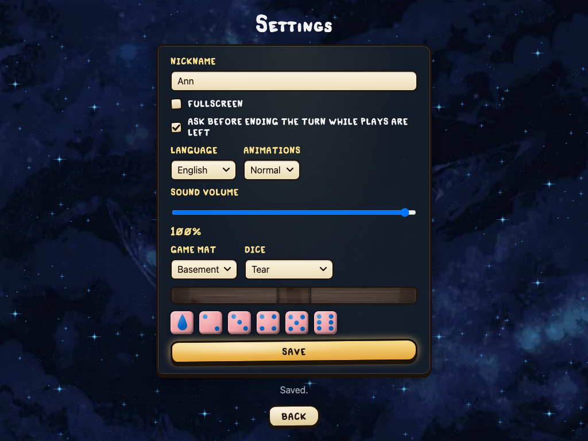

# Translate the interface

This page is for translators; you need no programming. You edit one JSON file per language, run one check, and look at screenshots of every screen in your language. The game's design for this is ADR 021 (`docs/architecture/021-localization.md`).

Card names and texts are not in this file: they live in the card data, see [Translate cards](Translate-cards). An AI agent can do the first draft for you: [Translating with an AI agent](Translating-with-an-AI-agent).

## 1. Get the code and the tools

You need a GitHub account, a terminal, and git. macOS: `xcode-select --install` gives git. Ubuntu or Debian: `sudo apt install git`. Fedora: `sudo dnf install git`. Windows is not covered yet (WSL with Ubuntu may work; it is not tested).

1. On GitHub, open [FourSoulsRepo/four_souls](https://github.com/FourSoulsRepo/four_souls) and press **Fork**. You get your own copy, `github.com/<you>/four_souls`.
2. Clone your fork and go into it:

   ```sh
   git clone https://github.com/<you>/four_souls.git
   cd four_souls
   ```

3. Install the tools a translator needs (Node.js, Go, the test browser):

   ```sh
   scripts/setup.sh --profile translator
   make doctor PROFILE=translator
   ```

   The script shows what it will install and asks once. [Developer setup](Developer-setup) explains every tool and what to do when something fails. On Linux, add the folders it names at the end to your `PATH` and open a new terminal.

Every command on this page runs from the `four_souls` folder.

## 2. Start a language

A language is one file: `frontend/src/locales/<code>.json`.

* `<code>` is the language's two-letter ISO 639-1 code in small letters: `de` German, `fr` French, `pl` Polish, `pt` Portuguese. A list: [ISO 639-1 codes](https://en.wikipedia.org/wiki/List_of_ISO_639-1_codes).
* A language with no two-letter code takes its three-letter ISO 639-3 code.
* One file per language; regional variants (`pt-BR`) are not supported.
* `en` is English, the source. `qps` is the developers' test language and is not a real file.

Start with an empty file, not a copy of `en.json`:

```sh
echo '{}' > frontend/src/locales/de.json
```

A copy of `en.json` would hold English notes and English texts; the check would flag every line ("holds text and note"), and English left in place cannot be told from a finished line. The check lists every line still to do instead (step 4).

As soon as the file exists, the language is a choice in the game's Settings, shown in its own name ("Deutsch"). Every line not translated yet shows in English, so a half-done file is fine.

## 3. Translate

`frontend/src/locales/en.json` holds every line: a key, the English `text`, and a `note` that says where the line shows and what each `{value}` is.

```json
"lobby.join": {
  "text": "Join",
  "note": "Button on a game's row in the LAN list or a server's game list: take a seat at that game."
}
```

Your file holds the key and your text only, no note:

```json
{
  "lobby.join": "Beitreten",
  "settings.save": "Speichern",
  "settings.title": "Einstellungen"
}
```

Keep the keys in the order of `en.json` (sorted by key), so one screen's lines sit together; the check accepts any order. Watch the JSON commas and quotes: every line but the last ends with `,`. A broken file stops the check with its line and a hint (step 4).

### Placeholders

`{name}` in a line is a value the game fills in: a number, a player, a card. Keep each one exactly as written, in English letters, and move it where your language needs it:

```json
"refuse.attack_cost": "Angreifen kostet {n}¢"
```

The English is "Attacking costs {n}¢"; the note says what each value is (here: the cents the attack costs). Text is never HTML; `<b>` shows as it is.

### Names stay in their dictionary form

A player's or a card's name is put in as it is, so it cannot take a case ending. English lines are written so that names stand alone: "{player} → {monster}: attack", not "{player} attacked {monster}" (ADR 021, item 15). Keep it that way in your language: build the sentence so each `{player}` or `{card}` needs no ending, even if it reads a little stiff.

A line that names "you" has two keys, `….you` and `….other` (`history.loot.you`, `history.loot.other`), so your language can use a different verb form for each.

### Plural forms

A line with a count holds one text per plural form instead of one text. English has two forms:

```json
"deck.loot": {
  "text": { "one": "Loot deck: {n} card", "other": "Loot deck: {n} cards" },
  "note": "Board: tooltip of the loot deck. n: cards in it."
}
```

Each language has its own forms, by their CLDR names: `zero`, `one`, `two`, `few`, `many`, `other`. Russian needs three:

```json
"deck.loot": { "one": "Колода добычи: {n} карта", "few": "Колода добычи: {n} карты", "many": "Колода добычи: {n} карт" }
```

`one` is for 1, 21, 31…; `few` for 2–4, 22–24…; `many` for 0, 5–20, 25…. German, like English, needs `one` and `other`.

To see which forms your language needs, run the check (step 4): a plural line it lists says "needs one, few, many", and `.cache/translations/<code>/todo.json` has `plural_forms` with the first numbers each form is for. The full table: [CLDR plural rules](https://www.unicode.org/cldr/charts/latest/supplemental/language_plural_rules.html). Fill only the forms the check asks for; a form your language does not have is an error.

One form may leave out `{n}`, for example a Russian "одна карта" in `one`; all forms together must still use every placeholder the English line has.

### The glossary

Game terms (loot, soul, treasure, cent, …) should read the same everywhere. `frontend/src/locales/glossary/en.json` lists each English term with a note on what it means. Write your words into `frontend/src/locales/glossary/<code>.json`, term → word:

```json
{
  "loot": "Beute",
  "soul": "Seele",
  "treasure": "Schatz"
}
```

Use only terms from `glossary/en.json`; leave out the ones you have not decided yet. The check does not test your lines against the glossary (word endings make that unreliable); the glossary is for you, other translators, and agents: `todo.json` names the terms each line uses, with your word.

### What not to translate

* Keys (`lobby.join`): they are how the game finds a line.
* Placeholders (`{player}`, `{n}`): the same names in every language.
* Card names: they come from the card data, in your language when [Translate cards](Translate-cards) has them.
* `en.json` itself: never edit it to translate.

## 4. Check

```sh
make i18n LOCALE=de
```

It prints one line per gap and fails (exit code not zero) while anything is left. Each line starts with the problem:

| Problem | Means | Fix |
|---|---|---|
| `missing` | the key is not in your file yet; the English text follows | add it |
| `placeholders` | your `{names}` differ from English | use exactly the English ones |
| `forms` | a plural line lacks a form your language needs | add the forms it names |
| `shape` | one text where English has plural forms, or the other way; or a copied note | match the English shape |
| `stray` | `en.json` no longer has this key | delete it from your file |

Example, from a German file with a few lines:

```text
de: 932 lines to do, of 937; todo: .cache/translations/de/todo.json
missing      actions.bad_target   not translated: Not a valid target.
forms        deck.loot            needs one, other; lacks other
shape        deck.monster         de has no plural form few; it uses one, other
placeholders refuse.attack_cost   has {cents}; English has {n}
```

The list comes first. The check runs inside the project's test runner, so after the list it prints a red `FAIL` block with `AssertionError: 932 lines to do in de: see the list above` and a few lines of code: that only says the check failed; the list above it is what matters. A plural line still missing shows its English forms as `{"one":"…","other":"…"}`.

### A file that is not JSON

A comma or a quote in the wrong place breaks the whole file. Then the check lists nothing else: it names the file, the line and the column, shows that line with a `^` under the place, and says what is likely wrong:

```text
frontend/src/locales/de.json:3:36: JSON error: a comma before }: delete this comma; the last entry has none
  3 |   "settings.title": "Einstellungen",
    |                                    ^
```

Fix it and run the check again. The hints:

| Hint | Fix |
|---|---|
| `a comma before }` (or `]`) | the last entry has no `,`; delete the one the `^` points at |
| `a comma is missing here` | add `,` where the `^` points, at the end of the line above the next entry |
| `its closing quote " is missing` | a text has no `"` at its end |
| `a quote is missing, or a quote inside a text lacks its backslash` | close the text, or write a `"` inside a text as `\"` |
| `a key needs double quotes` / `a text needs double quotes` | put `"…"` around it |
| `JSON takes double quotes " only` | replace `'` with `"` |
| `byte order mark (BOM)` | save the file as UTF-8 without BOM (an editor setting) |
| `the file is empty` | a new file starts as `{}` |
| `ends too early` | a closing `}`, `]` or `"` is missing at the end |

Without `LOCALE`, the project's test runner also loads the files into the game and prints its own `Failed to parse JSON file` block for the same mistake, with the line and column too.

Work in parts: `AREA=` keeps one area, the key's first word (`lobby`, `settings`, `history`, …):

```sh
make i18n LOCALE=de AREA=settings
```

It lists only that area and says how many lines other areas have left. When nothing is left, `make i18n LOCALE=de` passes.

The check also writes `.cache/translations/de/todo.json`: every line to do, grouped by area, with its English, note, placeholders, plural forms, and glossary words. It is meant for agents, but it is plain JSON and handy to read.

`make i18n` without `LOCALE` checks every language file for stray keys, shapes and placeholders only; missing lines are fine there. The project runs it on every change, so a half-done file passes it.

## 5. Look at the screens

The Settings screen lists the languages; each screen follows the chosen one:



```sh
make screenshots LOCALE=de
```

It plays through every screen in a hidden browser, in your language, and saves one PNG per screen into `.cache/screenshots/de/`. Open them and check by eye: lines that are cut off, too long for a button, or read wrong in context. English lines on them are lines your file does not have yet. `make screenshots` without `LOCALE` saves the English screens into `.cache/screenshots/`, to compare. [Screenshots](Screenshots) lists what each file shows.

The full run takes some ten minutes on two cores. It runs five browsers at once; on a computer with few cores (two or four) give it fewer, or tests run out of time:

```sh
make screenshots LOCALE=de E2E_WORKERS=2
```

The screenshots are taken by the game's UI tests. A test that fails on a slow machine, or one that needs the card images public copies lack (the dice menu test in `settings`, bug 19.82), only misses its own screenshots; the rest are saved. Running that one test file again (below) usually passes. Such a failure is rarely a mistake in your file; the check in step 4 is what tests the file.

To redo a few screens, name their test files, for example the settings and menu screens:

```sh
cd e2e && LOCALE=de SCREENSHOTS=1 npx playwright test --project chromium settings shell
```

The test files are in `e2e/tests/` (`settings.spec.ts` is `settings`). Screenshots are never committed.

## 6. When English changes

The game adds and changes lines. After you update your copy (step 7, "Later"), run `make i18n LOCALE=de` again:

* New lines show as `missing`.
* A line whose English meaning changed gets a new key, so it shows as `missing`, and its old key as `stray`: translate the new one and delete the old one.
* A small English fix (a typo) keeps its key; your line stays.

## 7. Send it

Send your file as a pull request on GitHub. A half-done translation is welcome: missing lines show in English.

1. Make a branch, commit, and push it to your fork. The first time, tell git your name: `git config --global user.name "Your Name"` and `git config --global user.email you@example.com`.

   ```sh
   git switch -c translate-de
   git add frontend/src/locales/de.json frontend/src/locales/glossary/de.json
   git commit -m "locales: German interface"
   git push -u origin translate-de
   ```

2. GitHub then shows a link, or a **Compare & pull request** button on your fork's page. Open the pull request against `FourSoulsRepo/four_souls`, branch `main`. Say in it how far the translation is and which screens you checked.
3. The maintainers review it; answer their comments with more commits on the same branch (`git commit`, `git push`).

Commit only your language files; never `.cache/` (the screenshots, `todo.json`), and never `en.json`.

Later, to bring your copy up to date with the game:

```sh
git remote add upstream https://github.com/FourSoulsRepo/four_souls.git   # once
git switch main && git pull upstream main
git switch -c translate-de-2
```

Then check again (step 6) and send a new pull request.
